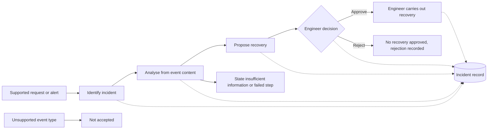

<!-- markdownlint-disable-file -->

# SRE Bot Managed Service Business Requirements

> **BRD-2026-Q4-001** | Status: draft | Version: 0.2.0 | Last Updated: 2026-11-23

> [!IMPORTANT]
> **DRAFT for human review.** Version 0.2.0 applies the automated quality review of v0.1.0 (report `BRD-2026-Q4-001-quality-20261123T050340Z`, Define gate BLOCKED). The Define gate has not been re-evaluated and the Govern gate has not started.
>
> - [ ] Reviewed and validated by a qualified human reviewer
>
> **Evidence labels.** *Fact* = stated by the source deck or a cited public source, not independently verified. *Assumption* = unsupported belief. *Decision* = confirmed by the user. *Proposed* = awaiting a human decision. No customer facts, metrics, prices or policy requirements have been invented. Unknown values are marked `Unknown`.
>
> The source deck is marked CONFIDENTIAL (PALO IT) and is cited by slide only. The user decided on 2026-11-23 that this marking is not a sharing constraint (D5). Context: `.copilot-tracking/research/2026-11-23/sre-bot-managed-service-context-summary.md`. Primary evidence: `.copilot-tracking/research/2026-11-23/sre-bot-context-discovery-research.md`.

## Executive Summary

On-call engineers handle incidents by hand: they respond to an alert, search logs to diagnose, then recover (Fact, C3 slide 3). The proposed managed service uses an SRE Bot that automates detection, root-cause analysis and recovery proposals while an engineer approves the final fix, and records every request and action on an incident record, a GitHub Issue per the deck, as the system of record (Fact, C3 slides 2, 3, 4).

The MVP scope is one Azure path with two triggers, Teams requests and Azure Monitor alerts, scoped for the HVE workshop and shown locally (Fact, C3 slides 5, 6; Decision D7). In the MVP the bot proposes recovery and the engineer carries it out (Decision D6). GitHub Issues replaces Jira (Decision D4).

The evidence supports the concept, rules and scope. It does not support the customer, buyer, baseline, target, price or competitive advantage. Primary success metric: `Unknown`; no baseline or target exists (BG-001, OQ-002), so no goal yet passes SMART. Azure SRE Agent documents overlapping capabilities (Fact, W1); positioning is deferred beyond the MVP (Decision D7, OQ-008).

---

## Business Context

* **Problem (Fact):** manual detect, diagnose, recover work and alert fatigue for on-call engineers (C3 slides 2, 3). Frequency, duration and cost of downtime are `Unknown`.
* **Strategic driver:** `Unknown`. The deck does not state whether the driver is cost, competitive or growth, or who the customer is (Session context open items).
* **Delivery context (Fact, Decision):** the MVP is scoped for the HVE workshop and shown locally, which may not equal a commercial launch scope (C3 slide 6; D7).
* **Alternatives (Fact):** Azure SRE Agent offers alert-driven investigation, Review and Autonomous run modes, Teams and GitHub integration and an audit trail, with usage-based billing (W1, W2). Non-AI automation and other competitors were not researched.
* **External constraint (Fact):** GitHub limits content creation to about 80 requests a minute and 500 an hour (W3).

---

## Stakeholders

Only the on-call engineer and the wider team are evidenced. Other rows are *Proposed* and need confirmation. Power and interest ratings are proposals for review, not findings.

| Stakeholder | Evidence | Power | Interest | Engagement strategy |
|---|---|---|---|---|
| On-call engineers | Fact (C3 slides 3, 4) | Medium | High | Involve in requirements review; they approve fixes |
| Wider operations team | Fact (C3 slide 4, shared incident record) | Low | High | Keep informed through the incident record |
| Business sponsor | `Unknown` | `Unknown` | `Unknown` | Identify (OQ-001) |
| Customer buyer or decision-maker | `Unknown` | `Unknown` | `Unknown` | Identify (OQ-001) |
| Managed-service owner and operator (PALO IT) | Assumption | High | High | Confirm ownership and sign-off |
| Platform and access administrators | Assumption | Medium | Medium | Consult on identity and permissions (OQ-010) |
| Security and compliance reviewers | Assumption | High | Medium | Consult on guardrails and data handling (OQ-010, OQ-011) |

Ownership gaps: sponsor, buyer, goal owners, approver authority and sign-off authority are not named (OQ-001).

---

## Design Decisions

| ID | Decision | Status | Basis |
|---|---|---|---|
| DD-001 | In the MVP, diagnosis uses only what arrives in the alert or Teams message, and the engineer runs any recovery. | Decision (user, 2026-11-23) | D6 |
| DD-002 | Requirements describe business behavior and avoid platform and command names. Those names appear in constraints, the Glossary and interface notes. | Decision (authoring) | BRD convention |
| DD-003 | Numeric baselines and targets stay `Unknown` rather than estimated. | Decision (authoring) | No metrics in evidence |
| DD-004 | The BRD and state file are stored under `.copilot-tracking/brd-sessions/`, as the user instructed. | Decision (user instruction) | User request |
| DD-005 | GitHub Issues is the incident record. Jira is not in scope, and the Jira mentions in the speaker notes are superseded. | Decision (user, 2026-11-23) | D4 |
| DD-006 | The deck's confidentiality marking is not treated as a sharing constraint for the deck and its summaries. Real incident, customer and tenant data still stay out of the repository. | Decision (user, 2026-11-23) | D5 |
| DD-007 | The MVP is shown locally. Positioning against Azure SRE Agent is deferred beyond the MVP. | Decision (user, 2026-11-23) | D7 |
| DD-008 | Treat alert, log, conversation and comment content as untrusted input, and define the service identity, permission limits, an emergency stop and action limits (NFR-005, NFR-006). | Proposed (awaiting human decision) | C6, C7; absent from the deck |
| DD-009 | Decide whether the offer is built, adopted from Azure SRE Agent, or combined with it before claiming differentiation. | Deferred beyond the MVP (DD-007) | W1, W2 |

---

## Business Goals

```text
BG-001: Reduce the manual effort and elapsed time for on-call engineers to reach a proposed recovery for an incident.
Priority: MUST
KPI: Time from acceptance of an incident event to a presented recovery proposal (candidate; not defined in the evidence).
Baseline: Unknown
Target: Unknown
Timeframe: Unknown (no dated horizon evidenced; requested under OQ-015)
Measurement source: Unknown
Owner: Unknown (to be named under OQ-001)
Evidence: Fact for the intent (C3 slides 2, 3); Unknown for the measure.
```

```text
BG-002: Keep an engineer in control of recovery and keep a traceable record of every request and bot action.
Priority: MUST
KPI: (a) Share of requests and bot actions with an entry on the incident record. (b) Share of presented proposals with a recorded engineer decision. Both candidates.
Baseline: Not applicable (new capability)
Target: Every request and action recorded, and every presented proposal decided and recorded (deck-stated rules, C3 slides 2, 3, 4)
Timeframe: Unknown (OQ-015)
Measurement source: Incident record
Owner: Unknown (OQ-001)
Evidence: Fact (C3 slides 2, 3, 4).
```

```text
BG-003: Demonstrate the MVP alert-to-incident-record path for the HVE workshop.
Priority: SHOULD
KPI: A demonstrated run for each of the two MVP triggers.
Baseline: Not applicable
Target: Both triggers demonstrated end to end
Timeframe: Workshop; date Unknown (OQ-015)
Measurement source: Workshop demonstration
Owner: Unknown (OQ-001)
Evidence: Fact for scope (C3 slide 6); Assumption that demonstration is the intended goal (OQ-015).
```

**SMART Evaluation** (assessed from the v0.1.0 quality review; Unknowns are honest, not invented):

| Goal | Specific | Measurable | Achievable | Relevant | Time-bound |
|---|---|---|---|---|---|
| BG-001 | Met | Not met (no baseline or target) | Not judgeable | Met | Not met |
| BG-002 | Met | Met (both measures) | Met | Met | Not met (no date or owner) |
| BG-003 | Met | Met | Met | Weakened (demonstration is an Assumption) | Not met (workshop date Unknown) |

**Status**: fail. Goals remain SMART-incomplete until OQ-001, OQ-002 and OQ-015 are answered, or a human grants a waiver or dated deferral.

### Outcome Hypothesis Handoff Provenance

No `OUTCOME_HYPOTHESIS_TO_BRD_HANDOFF_V1` payload was supplied. Not applicable.

---

## Business Rules

| ID | Rule | Category | Rationale | Enforceability | Enforcing FRs | Evidence |
|---|---|---|---|---|---|---|
| BR-001 | Recovery is carried out only by an engineer after the engineer has reviewed the proposal. | Operational | Keep human control of recovery | Mandatory | FR-004, FR-005, FR-009 | Fact (C3 slides 2, 3); restated from v0.1.0 so the service enforces presenting and recording, not carrying out |
| BR-002 | Every request and every bot action is recorded on the incident record. | Operational | Single source of truth and traceability | Mandatory | FR-006 | Fact (C3 slides 2, 4) |
| BR-003 | Retired: duplicates CON-001. | Not applicable | Not applicable | Not applicable | Not applicable | See CON-001 |
| BR-004 | In the MVP the bot proposes recovery and does not carry it out. Recovery without human approval is out of scope. | Operational | Human approval and D6 | Mandatory | FR-004 | Fact (C3 slide 6); Decision DD-001 |
| BR-005 | Retired: restates CON-004. | Not applicable | Not applicable | Not applicable | Not applicable | See CON-004 |

Not stated and therefore not recorded as rules: severity, escalation, approver authority, approval time limits, retention (OQ-010, OQ-011, OQ-012).

---

## Functional Requirements

Candidates derived from the deck. Command names are in the Glossary. Each FR cites its basis and is subject to human review.

| ID | Requirement | Actor | Trigger | Expected outcome | AC | Goals | Basis |
|---|---|---|---|---|---|---|---|
| FR-001 | The service accepts an incident event from either of the two MVP trigger types. "Accepted" is observable as an entry on the incident record or an acknowledgement in the conversation (*Proposed* observable). | Engineer, monitoring source | A request or an alert of a supported type | The event is accepted for handling | AC-001 | BG-001, BG-003 | Fact (C3 slides 5, 6) |
| FR-002 | The service identifies the incident. A recurrence of the same alert maps to the same incident. | Service | An accepted event | The incident is identified and recurrences are recognized | AC-002, AC-009 | BG-001 | Fact (C3 slides 3, 4); the matching rule is `Unknown` (OQ-006) |
| FR-003 | The service produces a root-cause analysis from the content of the event and cites the event content it relies on. | Service | An identified incident | An analysis with its cited basis is available to the engineer | AC-003 | BG-001 | Fact (C3 slide 3); DD-001; citing is *Proposed* |
| FR-004 | The service proposes a recovery for engineer review and does not carry it out. | Service | A completed analysis | A proposal is presented | AC-004 | BG-001, BG-002 | Fact (C3 slide 3); Decision DD-001 |
| FR-005 | The service records the engineer's approval or rejection of a proposal. | Engineer | A presented proposal | The decision is on the incident record | AC-005 | BG-002 | Fact (rule, C3 slides 2, 3); mechanism `Unknown` |
| FR-006 | The service records every request and every service action on the incident record. When the record cannot be written, NFR-003 applies. | Service | Any request or action | An entry exists on the record | AC-006 | BG-002 | Fact (C3 slides 2, 4) |
| FR-007 | The service reports status and results to the engineer in the conversation where the request was made. | Service, engineer | A request or a completed step | The result appears in that conversation | AC-007 | BG-001, BG-003 | Fact (C3 slides 4, 5) |
| FR-008 | The service does not accept an event of an unsupported trigger type in the MVP. Whether the sender is told is `Unknown` (OQ-016). | Service | An event of another type | The event is not accepted | AC-008 | BG-003 | Fact (C3 slides 5, 6) |
| FR-009 | When the engineer rejects a proposal, the service treats no recovery as approved and records the rejection. How a revised proposal is requested is `Unknown`. | Engineer, service | A rejected proposal | No recovery is approved and the rejection is recorded | AC-011 | BG-002 | Fact (BR-001); the revision path is *Proposed* |
| FR-010 | When a step fails or the event holds too little information, the service says so instead of presenting an unsupported result. | Service | A failed step or insufficient information | The engineer sees a clear statement | AC-010 | BG-001 | *Proposed* (quality review; RK-001) |

---

## Non-Functional Requirements

Evidence for non-functional needs is thin. Items marked *Proposed* are qualitative placeholders with `Unknown` targets and are not invented numbers.

### Functional Suitability

Not in MVP scope as a measured requirement. Accuracy expectations for root-cause analysis are `Unknown` (OQ-005).

### Performance Efficiency

* NFR-004 (*Proposed*): The elapsed time from event acceptance to a presented proposal is measured. Target and measurement window are `Unknown` (OQ-009). Owner: SME.

### Compatibility

Not evidenced beyond CON-002. Exchange formats are `Unknown` (OQ-015).

### Usability

Not in MVP scope. No usability need is evidenced.

### Reliability

* NFR-003 (*Proposed*): The service has a defined and observable behavior when the incident record or the conversation surface is unavailable or throttled (for example queue, retry or alert). The chosen behavior is `Unknown` (OQ-009). Basis: CON-005.

### Security

* NFR-001: Credentials and secrets used by the service are not present in code or on the incident record. Basis: Fact for the deck's use of a key vault (C3 slide 6); outcome wording is *Proposed*.
* NFR-002: Every audit entry on the incident record identifies who or what acted and what the action was. Basis: Fact for auditability (BR-002, C3 slides 2, 4); the two identifying attributes are *Proposed*.
* NFR-005 (*Proposed*): The service treats content from alerts, logs, conversations and comments as data and does not follow instructions found in it. Basis: C6, C7; absent from the deck (DD-008, OQ-010).
* NFR-006 (*Proposed*): The service acts under a defined identity with the least access needed and has an emergency stop and action limits. Basis: C6, C7 (DD-008, OQ-010).

### Maintainability

Not in MVP scope. No need is evidenced.

### Portability

Not in MVP scope. Non-Azure and local models are later phases (CON-003).

---

## Constraints

| ID | Constraint | Imposing source | Affected boundary | Non-negotiable | Category | Impact | Evidence |
|---|---|---|---|---|---|---|---|
| CON-001 | The MVP accepts only Teams requests and Azure Monitor alerts. | Source deck | Scope | Yes for the MVP | Technical | Scope of FR-001, FR-008 | Fact (C3 slides 5, 6) |
| CON-002 | The MVP runs on Azure with Microsoft Teams as the interaction surface and GitHub Issues as the incident record. No external imposer is confirmed. | Source deck (design choice) | Technology, integration | Unknown (OQ-007) | Technical | Platform for the MVP | Fact (C3 slides 4, 5, 6); Decision DD-005 |
| CON-003 | The MVP uses an Azure OpenAI model through Microsoft Foundry. Non-Azure or local models are later phases. | Source deck (design choice) | Technology | Unknown (OQ-007) | Technical | Model choice | Fact (C3 slide 6) |
| CON-004 | Real incident, customer and tenant data stay outside the repository. The deck's confidentiality marking is not a sharing constraint (DD-006). | Engagement evidence boundary (C1); user decision D5 | Evidence handling | Yes | Organizational | Evidence handling | Fact (C1); Decision (D5) |
| CON-005 | GitHub limits content creation to about 80 requests a minute and 500 an hour, with secondary limits that can change without notice. | GitHub | Integration, operations | Yes (external) | Technical | Burst handling for FR-006 | Fact (W3) |
| CON-006 | The MVP is scoped for the HVE workshop. The workshop date is `Unknown` (OQ-015). | Source deck | Schedule | Unknown | Schedule | Not a commercial launch scope | Fact (C3 slide 6) |
| CON-007 | The MVP is shown locally. What that implies for hosting is open (OQ-014). | User decision D7 | Operations | Yes | Technical | Demonstration scope | Decision (D7, DD-007) |

---

## Process Models

Observed from the deck with solution-agnostic labels. Dotted lines show recording on the incident record.



---

## Acceptance Criteria

| ID | Criterion | Covers | Status |
|---|---|---|---|
| AC-001 | Given the service is running, When a Teams request or an Azure Monitor alert arrives, Then it is accepted and the acceptance is observable on the incident record or in the conversation. | FR-001 | Not Started |
| AC-002 | Given an accepted event, When the service handles it, Then it identifies the incident and records the identification. | FR-002 | Not Started |
| AC-003 | Given an identified incident, When analysis completes, Then the analysis is available to the engineer and names the event content it relies on. | FR-003 | Not Started |
| AC-004 | Given a completed analysis, When the service proposes recovery, Then the proposal is presented for review and no recovery action is carried out by the service. | FR-004 | Not Started |
| AC-005 | Given a presented proposal, When the engineer approves or rejects it, Then the decision is recorded on the incident record. | FR-005 | Not Started |
| AC-006 | Given any request or service action, When it occurs, Then a corresponding entry exists on the incident record. | FR-006 | Not Started |
| AC-007 | Given a request made in a conversation, When a step completes, Then the status or result appears in that conversation. | FR-007 | Not Started |
| AC-008 | Given an event of a trigger type other than the two supported ones, When it arrives, Then it is not accepted for handling in the MVP. | FR-008 | Not Started |
| AC-009 | Given an alert that recurs, When it is handled again, Then it maps to the same incident record as the earlier occurrence (matching rule `Unknown`, OQ-006). | FR-002 | Not Started |
| AC-010 | Given a failed step or an event with too little information, When the service responds, Then it states the failure or the limit and does not present an unsupported analysis. | FR-010 | Not Started |
| AC-011 | Given a proposal the engineer rejects, When the rejection is made, Then no recovery is treated as approved and the rejection is recorded. | FR-009 | Not Started |
| AC-012 | Given the service and its incident record, When they are inspected, Then no credential or secret appears in code or on the record. | NFR-001 | Not Started |
| AC-013 | Given an entry on the incident record, When it is read, Then it identifies who or what acted and what the action was. | NFR-002 | Not Started |
| AC-014 | Given the incident record or conversation surface is unavailable or throttled, When the service tries to record or reply, Then the behavior defined under NFR-003 occurs and can be observed. | NFR-003 | Not Started |
| AC-015 | Given an accepted event and a presented proposal, When elapsed time is reviewed, Then it can be read from the incident record. Target `Unknown`. | NFR-004 | Not Started |
| AC-016 | Given an alert or message containing instruction-like text, When the service handles it, Then it does not act on that text and any proposal still requires engineer review. | NFR-005 | Not Started |
| AC-017 | Given the service identity, When its permissions and stop control are inspected, Then access is limited to what the service needs and an emergency stop exists (limits `Unknown`). | NFR-006 | Not Started |

Thresholds such as response time, accuracy and availability are not set because no evidence supports them.

---

## Traceability Matrix

### FR-to-AC Coverage

| FR | AC |
|---|---|
| FR-001 | AC-001 |
| FR-002 | AC-002, AC-009 |
| FR-003 | AC-003 |
| FR-004 | AC-004 |
| FR-005 | AC-005 |
| FR-006 | AC-006 |
| FR-007 | AC-007 |
| FR-008 | AC-008 |
| FR-009 | AC-011 |
| FR-010 | AC-010 |

Coverage: 10 of 10 FRs have an AC = 100.0%.

### FR-to-BG Alignment

| FR | BG |
|---|---|
| FR-001 | BG-001, BG-003 |
| FR-002 | BG-001 |
| FR-003 | BG-001 |
| FR-004 | BG-001, BG-002 |
| FR-005 | BG-002 |
| FR-006 | BG-002 |
| FR-007 | BG-001, BG-003 |
| FR-008 | BG-003 |
| FR-009 | BG-002 |
| FR-010 | BG-001 |

Coverage: 10 of 10 FRs have a BG = 100.0%.

### BR-to-FR Enforcement

| BR | Enforcing FR |
|---|---|
| BR-001 | FR-004, FR-005, FR-009 |
| BR-002 | FR-006 |
| BR-003 | Retired (see CON-001, FR-001, FR-008) |
| BR-004 | FR-004 |
| BR-005 | Retired (see CON-004) |

### NFR-to-AC Verification

| NFR | AC |
|---|---|
| NFR-001 | AC-012 |
| NFR-002 | AC-013 |
| NFR-003 | AC-014 |
| NFR-004 | AC-015 |
| NFR-005 | AC-016 |
| NFR-006 | AC-017 |

---

## Risks and Assumptions

### Key Assumptions

| ID | Assumption | Evidence status | Impact if false | Mitigation | Source |
|---|---|---|---|---|---|
| A-001 | The target customer is an organization running Azure workloads with an on-call team. | Untested | Wrong segment and scope | Confirm segment (OQ-001) | BRD discovery |
| A-002 | Alert and Teams message content is rich enough for useful root-cause analysis. | Untested | Analysis quality too low | Define minimum event content (OQ-005) | DD-001 |
| A-003 | A recurring alert should map to an existing incident record. | Partially supported | Duplicate records | Confirm matching rule (OQ-006) | C3 slides 4, 5 |
| A-004 | The slide content is current and the speaker notes mentioning Jira are stale. | Evidenced (user decision D4, DD-005) | Wrong scope | Closed | C3 notes; user |
| A-005 | Engineers will review proposals carefully rather than approve by habit. | Untested | Unsafe approvals | Observe in workshop | BRD discovery |

### Research Finding Dispositions

| Gap ID | Evidence IDs | Affected targets | Disposition | Rationale | Primary research artifact |
|---|---|---|---|---|---|
| Finding: Business facts | C3 | Business Context, BG-001 | Incorporated | Concept consistent; impact unquantified | .copilot-tracking/research/2026-11-23/sre-bot-context-discovery-research.md |
| Finding: Affected users | C3 | Stakeholders | Incorporated | Only engineer and team evidenced | same |
| Finding: Business rules | C3 | BR-001, BR-002, BR-004 | Incorporated | Stated in the deck | same |
| Finding: Constraints | C1, C3, W3 | CON-001 to CON-007 | Incorporated | Stated or documented | same |
| Finding: Diagnosis and recovery mechanism | C3, D6 | FR-003, FR-004, BR-004, DD-001 | Incorporated | User confirmed option A | same |
| Finding: Known failure cases | none | Risk Register, FR-010 | Retained-assumption | Failure modes unverified | same |
| Finding: AI guardrails | C3, C6, C7 | DD-008, NFR-005, NFR-006, OQ-010 | Deferred | Proposed pending human decision | same |
| Finding: Azure SRE Agent overlap | W1, W2 | DD-009, OQ-008 | Deferred | MVP shown locally; positioning deferred (D7) | same |

### Risk Register

| ID | Risk | Probability | Impact | Mitigation |
|---|---|---|---|---|
| RK-001 | A wrong root cause is presented with confidence and approved. | Medium (unverified) | High | FR-003 cites its basis; FR-010; BR-001; test with synthetic cases |
| RK-002 | Indirect prompt injection or excessive agency through alert, log or comment content. | Medium (unverified) | High | DD-008; NFR-005, NFR-006 |
| RK-003 | First-party overlap (Azure SRE Agent) weakens differentiation and revenue after the MVP. | High | High (after the MVP) | DD-009; comparison deferred beyond the MVP |
| RK-004 | Alert bursts hit GitHub content limits, delaying records. | Medium (volumes unknown) | Medium | NFR-003; estimate volumes (OQ-009) |
| RK-005 | Sensitive log content is stored in incident records. | Medium (unverified) | High | Decide classification, visibility and redaction (OQ-011) |
| RK-006 | Confidential deck shared beyond approved audiences. | Closed (D5, DD-006) | Not tracked | None |
| RK-007 | Inconsistent source material (Jira notes) leads to wrong scope. | Closed (D4, DD-005) | Not applicable | None |

---

## Open Questions

| ID | Question or gap | Why it matters | Owner | Target date | Status | Rationale for deferral | Target phase | Source |
|---|---|---|---|---|---|---|---|---|
| OQ-001 | Who is the target customer segment, buyer, sponsor and owner of each goal? | Stakeholders, value, sign-off, goal owners | SME, PM | Unassigned | Open |  |  | Session context |
| OQ-002 | What are the baselines and targets for time, effort and recovery? | BG-001 cannot pass SMART | SME | Unassigned | Open |  |  | Research |
| OQ-003 | Is Jira in scope, or is GitHub Issues the only record? | Scope of FR-006 and CON-002 | SME | 2026-11-23 | Resolved: GitHub Issues replaces Jira (DD-005) |  |  | D4 |
| OQ-004 | May the deck and summaries be shared beyond the team? | Evidence handling | Owner | 2026-11-23 | Resolved: confidentiality marking is not a sharing constraint (DD-006) |  |  | D5 |
| OQ-005 | What is the minimum content of an alert or message, and what accuracy is expected from analysis? | Quality of FR-003 | SME | Unassigned | Open |  |  | DD-001 |
| OQ-006 | What rule decides a recurring alert maps to an existing incident? | FR-002, AC-009 | SME | Unassigned | Open |  |  | C3 slide 4 |
| OQ-007 | Are Teams, Azure, GitHub Issues and the Azure OpenAI model non-negotiable for the customer or only for the workshop? | Reclassify CON-002, CON-003 | PM | Unassigned | Open |  |  | C3 slide 6 |
| OQ-008 | How does the offer position against Azure SRE Agent (build, adopt or combine)? | Advantage, channel, revenue | PM | Unassigned | Deferred | The MVP is shown locally (D7, DD-007); positioning is not needed for the MVP | Future-Release | D7 |
| OQ-009 | What alert volumes, latency, availability and outage behavior are expected? | NFR-003, NFR-004, CON-005 | SME | Unassigned | Open |  |  | W3 |
| OQ-010 | What identity, permissions, approver authority, emergency stop and prompt-injection controls apply? | DD-008, NFR-005, NFR-006 | Security, SME | Unassigned | Open |  |  | DD-008 |
| OQ-011 | Where may incident data be stored, with what visibility, redaction and retention? | Confidentiality | Security, Owner | Unassigned | Open |  |  | Research |
| OQ-012 | What severity, escalation and approval time-limit rules apply? | Business rules | SME | Unassigned | Open |  |  | Research |
| OQ-013 | What is the revenue model, price and delivery channel? | Business case | PM | Unassigned | Deferred | Commercial work depends on OQ-001 and OQ-008 | PRD | Lean canvas |
| OQ-014 | What does "shown locally" mean for the MVP: components run on a local machine, or the Azure services run and are demonstrated locally? | CON-002, CON-003, CON-007, dependencies | SME | Unassigned | Open |  |  | D7 |
| OQ-015 | What is the workshop date and review window, and is demonstration the intended goal for BG-003? | Time-bound and relevance of BG-001 to BG-003 | SME | Unassigned | Open |  |  | Quality review |
| OQ-016 | Is the sender told when an unsupported event is not accepted, and how is a revised proposal requested? | FR-008, FR-009 | SME | Unassigned | Open |  |  | Quality review |

---

## Scope and Non-Goals

**In scope (MVP, Fact, C3 slides 5, 6):** two triggers (Teams requests, Azure Monitor alerts), identification of incidents, root-cause analysis from event content, recovery proposals for engineer approval, recording on the incident record, replies in the conversation.

**Non-goals for the MVP (Fact, C3 slides 5, 6):** file uploads and screenshots, on-prem and SNMP alerts, scheduled jobs, AWS and GCP health events, email and web portal intake, non-Azure or local models, recovery without human approval. Also out of scope for this BRD: architecture, implementation commitments, pricing and a competitor survey.

**Dependencies:** access to the monitoring source, the interaction surface and the incident record; model availability; the answers to OQ-001, OQ-010, OQ-011 and OQ-014. Named platform services are recorded as constraints, not commitments.

---

## Glossary

| Term | Definition | Context |
|---|---|---|
| SRE Bot, the service | The automated assistant that identifies incidents, analyses and proposes recovery | Deck term |
| Incident record | The single record where requests and actions are logged; a GitHub Issue per the deck | BR-002 |
| Fingerprint | Identifying an incident so recurrences map to it. The matching rule is `Unknown` (OQ-006). | C3 slide 3 |
| `/detect` | The deck's command that identifies and fingerprints an incident (FR-002) | C3 slide 3 |
| `/analysis` | The deck's command for root-cause analysis (FR-003) | C3 slide 3 |
| `/recover` | The deck's command that proposes recovery (FR-004). In the MVP it does not execute. | C3 slide 3; DD-001 |
| Teams thread, conversation | The Microsoft Teams conversation where a request is made | C3 slides 4, 5 |
| MVP | The workshop-scoped first version, shown locally | CON-006, CON-007 |

---

## Sign-Off

### Approval Checklist

* Business Sponsor: Unassigned - approves business case and strategic alignment.
* Product Owner: Unassigned - approves requirements completeness and feasibility.
* Technical Lead: Unassigned - approves technical feasibility and constraints.
* Quality Lead: Unassigned - approves quality criteria and acceptance coverage.
* Legal/Compliance: Unassigned - approves regulatory and policy compliance when required.

Approval date: Not approved.

### Waivers

None recorded.

### Handoff Readiness

Not ready. The Define gate was BLOCKED on v0.1.0 and has not been re-evaluated on v0.2.0. All goals are SMART-incomplete, sponsor, buyer and goal owners are not named, the guardrail requirements are only Proposed, and there is no approved BRD. No `BRD_TO_PRD_HANDOFF_V1` was produced.

---

## Disclaimer

> [!CAUTION]
> **Disclaimer:** This agent is an assistive tool only. It does not provide business approval, regulatory compliance validation, or executive sign-off and does not replace business analysts, stakeholder representatives, compliance teams, or other qualified human reviewers. The output consists of suggested business requirements, objectives, and scope definitions to support a user's own business analysis and decision-making. All Business Requirements Documents, business objectives, stakeholder analysis, and requirement traceability generated by this tool must be independently reviewed and validated by appropriate business and compliance reviewers before adoption. Outputs from this tool do not constitute business approval, requirements sign-off, or stakeholder commitment.

---

## Document Metadata

* Template Version: 1.0.0.
* Canonical Template: `requirements-author/templates/brd/brd-full.md`.
* License: CC-BY 4.0 (Microsoft HVE-Core).
* Attribution: Microsoft HVE-Core Team.
* Revision: 0.2.0 applies the automated quality review findings that needed no new facts. Findings that need new facts remain as open questions.
* Evidence IDs: C1, C3, C6, C7, W1, W2, W3 as defined in `.copilot-tracking/research/2026-11-23/sre-bot-context-discovery-research.md` (C3 is the source deck, cited by slide).
