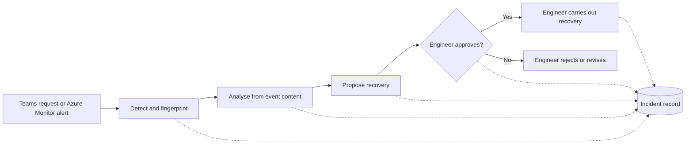

<!-- markdownlint-disable-file -->

# SRE Bot Managed Service Business Requirements

> **BRD-2026-Q4-001** | Status: draft | Version: 0.1.0 | Last Updated: 2026-11-23

> [!IMPORTANT]
> **DRAFT for human review.** Discover and Define gates have not been passed and the BRD Quality Reviewer has not been run.
>
> - [ ] Reviewed and validated by a qualified human reviewer
>
> **How to read evidence labels.** *Fact* = stated by the source deck or a cited public source, not independently verified. *Assumption* = unsupported belief. *Decision* = confirmed by the user. *Proposed* = awaiting a human decision. No customer facts, metrics, prices or policy requirements have been invented. Unknown values are marked `Unknown`.
>
> The source deck is CONFIDENTIAL (PALO IT) and is cited by slide only. Context: `.copilot-tracking/research/2026-11-23/sre-bot-managed-service-context-summary.md`. Primary evidence: `.copilot-tracking/research/2026-11-23/sre-bot-context-discovery-research.md`.

## Executive Summary

On-call engineers handle incidents by hand: they respond to an alert, search logs to diagnose, then recover (Fact, C3 slide 3). The proposed managed service uses an SRE Bot that automates detection, root-cause analysis and recovery proposals while an engineer approves the final fix, and records every request and action in a GitHub Issue as the system of record (Fact, C3 slides 2, 3, 4).

The MVP scope is one Azure path with two triggers, Teams requests and Azure Monitor alerts, and is scoped for the HVE workshop (Fact, C3 slides 5, 6). The user confirmed that in the MVP the bot proposes recovery and the engineer carries it out (Decision D6).

The evidence supports the concept, rules and scope. It does not support the customer, buyer, baseline, target, price or competitive advantage. Primary success metric: `Unknown`; no baseline or target exists (see BG-001 and OQ-002). A first-party product, Azure SRE Agent, documents overlapping capabilities (Fact, W1), so positioning is an open decision (OQ-008).

---

## Business Context

* **Problem (Fact):** manual detect, diagnose, recover work and alert fatigue for on-call engineers (C3 slides 2, 3). Frequency, duration and cost of downtime are `Unknown`.
* **Strategic driver:** `Unknown`. The deck does not state whether the driver is cost, competitive or growth, or who the customer is (Session context open items).
* **Delivery context (Fact):** the MVP is scoped "for the HVE workshop", which may not equal a commercial launch scope (C3 slide 6).
* **Alternatives (Fact):** Azure SRE Agent offers alert-driven investigation, Review and Autonomous run modes, Teams and GitHub integration and an audit trail, with usage-based billing (W1, W2). Non-AI automation and other competitors were not researched.
* **External constraint (Fact):** GitHub limits content creation to about 80 requests a minute and 500 an hour (W3).

---

## Stakeholders

Only the on-call engineer and the wider team are evidenced. Other rows are *Proposed* and need confirmation. Power and interest ratings are proposals for review, not findings.

| Stakeholder | Evidence | Power | Interest | Engagement strategy |
|---|---|---|---|---|
| On-call engineers | Fact (C3 slides 3, 4) | Medium | High | Involve in requirements review; they approve fixes |
| Wider operations team | Fact (C3 slide 4, shared issue) | Low | High | Keep informed through the issue record |
| Business sponsor | `Unknown` | `Unknown` | `Unknown` | Identify (OQ-001) |
| Customer buyer or decision-maker | `Unknown` | `Unknown` | `Unknown` | Identify (OQ-001) |
| Managed-service owner and operator (PALO IT) | Assumption | High | High | Confirm ownership and sign-off |
| Platform and access administrators | Assumption | Medium | Medium | Consult on identity and permissions (OQ-010) |
| Security and compliance reviewers | Assumption | High | Medium | Consult on guardrails and data handling (OQ-010, OQ-011) |

Ownership gaps: sponsor, buyer, approver authority and sign-off authority are not named.

---

## Design Decisions

| ID | Decision | Status | Basis |
|---|---|---|---|
| DD-001 | In the MVP, diagnosis uses only what arrives in the alert or Teams message, and the engineer runs any recovery. | Decision (user confirmed 2026-11-23) | D6 |
| DD-002 | Requirements are written solution-agnostic. Platform choices named in the deck (Teams, Azure, GitHub Issues) are recorded as constraints. | Decision (authoring) | BRD template convention |
| DD-003 | Numeric baselines and targets are left `Unknown` rather than estimated. | Decision (authoring) | No metrics in evidence |
| DD-004 | The BRD and state file are stored under `.copilot-tracking/brd-sessions/`, as the user instructed, not `docs/project-planning/`. | Decision (user instruction) | User request |

### Proposed decisions (awaiting a human decision)

| ID | Proposal | Status | Basis |
|---|---|---|---|
| PD-001 | Treat alert, log, Teams and comment content as untrusted input to the model, and define the bot's identity, permission limits, an emergency stop and action limits. | Proposed | C6, C7; absent from the deck |
| PD-002 | Decide whether the offer is built, adopted from Azure SRE Agent, or combined with it, before claiming differentiation. | Proposed (maps to D7) | W1, W2 |

---

## Business Goals

```text
BG-001: Reduce the manual effort and elapsed time for on-call engineers to reach a proposed recovery for an incident.
Priority: MUST
KPI: Candidate: time from alert to a proposed recovery. Not defined in the evidence.
Baseline: Unknown
Target: Unknown
Timeframe: Unknown
Measurement source: Unknown
Owner: Unknown
Evidence: Fact for the intent (C3 slides 2, 3); Unknown for the measure.
```

```text
BG-002: Keep an engineer in control of recovery and keep a traceable record of every request and bot action.
Priority: MUST
KPI: Share of requests and bot actions with an entry on the incident record. Candidate only.
Baseline: Not applicable (new capability)
Target: Every request and action recorded (deck-stated rule, C3 slides 2, 4)
Timeframe: Unknown
Measurement source: Incident record (GitHub Issue per the deck)
Owner: Unknown
Evidence: Fact (C3 slides 2, 4).
```

```text
BG-003: Demonstrate the MVP alert-to-incident-record path for the HVE workshop.
Priority: SHOULD
KPI: A demonstrated run for each of the two MVP triggers.
Baseline: Not applicable
Target: Both triggers demonstrated end to end
Timeframe: Unknown (workshop date not stated)
Measurement source: Workshop demonstration
Owner: Unknown
Evidence: Fact for scope (C3 slide 6); Assumption that demonstration is the goal.
```

**SMART Evaluation** (assessed at Define to Govern gate):

- [ ] **S**pecific
- [ ] **M**easurable (BG-001 has no baseline or target)
- [ ] **A**chievable
- [ ] **R**elevant
- [ ] **T**ime-bound (no dates are evidenced)

**Status**: deferred (populated at Define to Govern assessment)

### Outcome Hypothesis Handoff Provenance

No `OUTCOME_HYPOTHESIS_TO_BRD_HANDOFF_V1` payload was supplied. Not applicable.

---

## Business Rules

| ID | Rule | Category | Rationale | Enforceability | Enforcing FRs | Evidence |
|---|---|---|---|---|---|---|
| BR-001 | An engineer approves the final fix before it is carried out. | Operational | Keep human control of recovery | Mandatory | FR-004, FR-005 | Fact (C3 slides 2, 3) |
| BR-002 | Every request and every bot action is recorded on the incident record. | Operational | Single source of truth and traceability | Mandatory | FR-006 | Fact (C3 slides 2, 4) |
| BR-003 | The MVP accepts only Teams requests and Azure Monitor alerts as triggers. | Operational | Bounded MVP scope | Mandatory | FR-001 | Fact (C3 slides 5, 6) |
| BR-004 | In the MVP the bot proposes recovery but does not execute it. Recovery without human approval is out of scope. | Operational | Human approval and D6 | Mandatory | FR-004 | Fact (C3 slide 6); Decision DD-001 |
| BR-005 | No real incident logs, customer data, credentials or tenant identifiers are placed in the repository. | Policy | Evidence boundary | Mandatory | (none; enforced by engagement process) | Fact (C1) |

Not stated and therefore not recorded as rules: severity, escalation, approver authority, approval time limits, retention.

---

## Functional Requirements

Candidates derived from the deck. Each is labelled with its basis and is subject to human review.

| ID | Requirement | Actor | Trigger | Expected outcome | Acceptance | Business goals | Basis |
|---|---|---|---|---|---|---|---|
| FR-001 | The service accepts incident events from the two MVP trigger types. | Engineer, monitoring source | A Teams request or an Azure Monitor alert | The event is accepted for handling | AC-001 | BG-001, BG-003 | Fact (C3 slides 5, 6) |
| FR-002 | The service identifies the incident and fingerprints it (`/detect`). | SRE Bot | An accepted event | The incident is identified and distinguishable from others | AC-002 | BG-001 | Fact (C3 slide 3); the matching rule is `Unknown` |
| FR-003 | The service produces a root-cause analysis from the content of the incident event (`/analysis`). | SRE Bot | An identified incident | A root-cause analysis is available to the engineer | AC-003 | BG-001 | Fact (C3 slide 3); input limited per DD-001 |
| FR-004 | The service proposes a recovery action for engineer review and does not carry it out (`/recover`). | SRE Bot | A completed analysis | A proposed recovery is presented | AC-004 | BG-001, BG-002 | Fact (C3 slide 3); Decision DD-001 |
| FR-005 | The service records the engineer's approval or rejection of a proposed recovery. | Engineer | A presented proposal | The decision is captured on the incident record | AC-005 | BG-002 | Fact (BR-001); mechanism `Unknown` |
| FR-006 | The service records every request and bot action on the incident record. | SRE Bot | Any request or bot action | An entry exists on the incident record | AC-006 | BG-002 | Fact (C3 slides 2, 4) |
| FR-007 | The service reports status and results back to the engineer in the conversation where the request was made. | SRE Bot, engineer | A request or a completed step | The engineer sees the result in the same Teams thread | AC-007 | BG-001, BG-003 | Fact (C3 slides 4, 5) |

---

## Non-Functional Requirements

No non-functional requirement is evidenced beyond the items below. Gaps are open questions rather than assumed values.

### Functional Suitability

`None evidenced.` Accuracy expectations for root-cause analysis are `Unknown` (OQ-005).

### Performance Efficiency

`None evidenced.` Latency and burst-handling needs are `Unknown` (OQ-009). GitHub content limits apply (CON-005).

### Compatibility

`None evidenced.`

### Usability

`None evidenced.`

### Reliability

`None evidenced.` Availability and failure handling are `Unknown` (OQ-005, OQ-009).

### Security

* NFR-001: Credentials and secrets used by the service are held in a managed secret store and not in code or the incident record. Basis: Fact for the stated use of a key vault (C3 slide 6); the requirement wording is *Proposed*.
* Prompt-injection, identity and permission limits: see PD-001 and OQ-010.

### Maintainability

* NFR-002: Every action taken by the service is auditable after the fact from the incident record. Basis: Fact (BR-002, C3 slides 2, 4). Verified by AC-006.

### Portability

`None evidenced.` Non-Azure and local models are out of the MVP (CON-003).

---

## Constraints

| ID | Constraint | Imposing source | Category | Impact | Evidence |
|---|---|---|---|---|---|
| CON-001 | The MVP accepts only Teams requests and Azure Monitor alerts. | Source deck | Technical | Scope of FR-001 | Fact (C3 slides 5, 6) |
| CON-002 | The MVP runs on Azure with Microsoft Teams as the interaction surface and GitHub Issues as the system of record. | Source deck | Technical | Platform choice for the MVP | Fact (C3 slides 4, 5, 6); to be confirmed as non-negotiable (OQ-007) |
| CON-003 | The MVP uses an Azure OpenAI model through Microsoft Foundry. Non-Azure or local models are later phases. | Source deck | Technical | Model choice | Fact (C3 slide 6) |
| CON-004 | The source deck is confidential, and real incident, customer and tenant data stay outside the repository. | Session context | Organizational | Evidence handling | Fact (C1) |
| CON-005 | GitHub limits content creation to about 80 requests a minute and 500 an hour, with secondary limits that can change without notice. | GitHub | Technical | Burst handling for FR-006 | Fact (W3) |
| CON-006 | The MVP is scoped for the HVE workshop. | Source deck | Schedule | Not a commercial launch scope | Fact (C3 slide 6) |

---

## Process Models

Observed from the deck, solution-agnostic labels. Dotted lines show recording on the incident record.



---

## Acceptance Criteria

| ID | Criterion | Covers | Status |
|---|---|---|---|
| AC-001 | Given the service is running, When a Teams request or an Azure Monitor alert arrives, Then the service accepts it for handling. And When any other trigger type arrives, Then it is not accepted in the MVP. | FR-001 | Not Started |
| AC-002 | Given an accepted event, When the service handles it, Then it identifies and fingerprints the incident. | FR-002 | Not Started |
| AC-003 | Given an identified incident, When analysis completes, Then a root-cause analysis based on the event content is available to the engineer. | FR-003 | Not Started |
| AC-004 | Given a completed analysis, When the service proposes recovery, Then the proposal is presented for review and no recovery action is carried out by the service. | FR-004 | Not Started |
| AC-005 | Given a presented proposal, When the engineer approves or rejects it, Then the decision is recorded on the incident record. | FR-005 | Not Started |
| AC-006 | Given any request or bot action, When it occurs, Then a corresponding entry exists on the incident record. | FR-006 | Not Started |
| AC-007 | Given a request made in a Teams thread, When a step completes, Then the engineer sees the status or result in that thread. | FR-007 | Not Started |

Thresholds such as response time, accuracy or availability are not set because no evidence supports them.

---

## Traceability Matrix

### FR-to-AC Coverage

| FR | AC |
|---|---|
| FR-001 | AC-001 |
| FR-002 | AC-002 |
| FR-003 | AC-003 |
| FR-004 | AC-004 |
| FR-005 | AC-005 |
| FR-006 | AC-006 |
| FR-007 | AC-007 |

Coverage: 7 of 7 FRs have an AC = 100.0%.

### FR-to-BG Alignment

| FR | BG |
|---|---|
| FR-001 | BG-001, BG-003 |
| FR-002 | BG-001 |
| FR-003 | BG-001 |
| FR-004 | BG-001, BG-002 |
| FR-005 | BG-002 |
| FR-006 | BG-002 |
| FR-007 | BG-001, BG-003 |

Coverage: 7 of 7 FRs have a BG = 100.0%.

### BR-to-FR Enforcement

| BR | Enforcing FR |
|---|---|
| BR-001 | FR-004, FR-005 |
| BR-002 | FR-006 |
| BR-003 | FR-001 |
| BR-004 | FR-004 |
| BR-005 | (none) enforced by the engagement evidence process outside the solution scope |

---

## Risks and Assumptions

### Key Assumptions

| ID | Assumption | Evidence status | Impact if false | Mitigation | Source |
|---|---|---|---|---|---|
| A-001 | The target customer is an organization running Azure workloads with an on-call team. | Untested | Wrong segment and scope | Confirm segment (OQ-001) | BRD discovery |
| A-002 | Alert and Teams message content is rich enough for useful root-cause analysis. | Untested | Analysis quality too low | Define minimum event content (OQ-005) | DD-001 |
| A-003 | A recurring alert should link to an existing incident record. | Partially supported | Duplicate records | Confirm matching rule (OQ-006) | C3 slides 4, 5 |
| A-004 | The slide content is current and the speaker notes mentioning Jira are stale. | Partially supported | Wrong scope | Confirm (OQ-003) | C3 notes |
| A-005 | Engineers will review proposals carefully rather than approve by habit. | Untested | Unsafe approvals | Observe in workshop | BRD discovery |

### Research Finding Dispositions

| Gap ID | Evidence IDs | Affected targets | Disposition | Rationale | Primary research artifact |
|---|---|---|---|---|---|
| Finding: Business facts | C3 | Business Context, BG-001 | Incorporated | Concept consistent across slides; impact unquantified | .copilot-tracking/research/2026-11-23/sre-bot-context-discovery-research.md |
| Finding: Affected users | C3 | Stakeholders | Incorporated | Evidence limited to engineers and team; others marked Assumption | same |
| Finding: Business rules | C3 | BR-001 to BR-004 | Incorporated | Stated in the deck | same |
| Finding: Constraints | C1, C3, W3 | CON-001 to CON-006 | Incorporated | Stated or documented | same |
| Finding: Diagnosis and recovery mechanism | C3, D6 | FR-003, FR-004, BR-004, DD-001 | Incorporated | User confirmed option A | same |
| Finding: Known failure cases | none | Risk Register | Retained-assumption | Failure modes unverified | same |
| Finding: AI guardrails | C3, C6, C7 | PD-001, OQ-010 | Deferred | Needs a human decision | same |
| Finding: Azure SRE Agent overlap | W1, W2 | PD-002, OQ-008 | Deferred | Needs PM and customer evidence | same |

### Risk Register

| ID | Risk | Probability | Impact | Mitigation |
|---|---|---|---|---|
| RK-001 | A wrong root cause is presented with confidence and approved. | Medium (unverified) | High | Show evidence with each analysis; require engineer review (BR-001); test with synthetic cases |
| RK-002 | Indirect prompt injection or excessive agency through alert, log or comment content. | Medium (unverified) | High | PD-001; define identity, permissions and limits |
| RK-003 | First-party overlap (Azure SRE Agent) weakens differentiation and revenue. | High | High | PD-002; PM comparison |
| RK-004 | Alert bursts hit GitHub content limits, delaying records. | Medium (volumes unknown) | Medium | Estimate volumes (OQ-009); design batching later |
| RK-005 | Sensitive log content is stored in incident records. | Medium (unverified) | High | Decide repository visibility and redaction (OQ-011) |
| RK-006 | The confidential deck and its summaries are shared beyond approved audiences. | Medium | High | Confirm classification and sharing (OQ-004) |
| RK-007 | Inconsistent source material (Jira notes) leads to wrong scope. | Medium | Medium | Resolve OQ-003 |

---

## Open Questions

| ID | Question or gap | Why it matters | Owner | Target date | Status | Rationale for deferral | Target phase | Source |
|---|---|---|---|---|---|---|---|---|
| OQ-001 | Who is the target customer segment, buyer and sponsor? | Defines stakeholders, value and sign-off | SME, PM | Unassigned | Open |  |  | Session context |
| OQ-002 | What are the baselines and targets for time, effort and recovery? | BG-001 cannot pass SMART | SME | Unassigned | Open |  |  | Research |
| OQ-003 | Is Jira in scope, or is GitHub Issues the only record? | Scope of FR-006 and CON-002 | SME | Unassigned | Open |  |  | D4 |
| OQ-004 | May the deck and summaries be shared beyond the team? | Evidence handling | Owner | Unassigned | Open |  |  | D5 |
| OQ-005 | What is the minimum content of an alert or Teams message, and what accuracy is expected from analysis? | Quality of FR-003 | SME | Unassigned | Open |  |  | DD-001 |
| OQ-006 | What rule decides a recurring alert belongs to an existing incident? | FR-002 | SME | Unassigned | Open |  |  | C3 slide 4 |
| OQ-007 | Are Teams, Azure and GitHub Issues non-negotiable for the customer or only for the workshop? | Reclassify CON-002 | PM | Unassigned | Open |  |  | C3 slide 6 |
| OQ-008 | How does the offer position against Azure SRE Agent (build, adopt or combine)? | Advantage, channel, revenue | PM | Unassigned | Open |  |  | D7 |
| OQ-009 | What alert volumes, latency and availability are expected? | NFRs and GitHub limits | SME | Unassigned | Open |  |  | W3 |
| OQ-010 | What identity, permissions, approver authority, emergency stop and prompt-injection controls apply? | Guardrails | Security, SME | Unassigned | Open |  |  | PD-001 |
| OQ-011 | Where may incident data be stored, with what visibility, redaction and retention? | Confidentiality | Security, Owner | Unassigned | Open |  |  | Research |
| OQ-012 | What severity, escalation and approval time-limit rules apply? | Business rules | SME | Unassigned | Open |  |  | Research |
| OQ-013 | What is the revenue model, price and delivery channel? | Business case | PM | Unassigned | Deferred | Commercial work depends on OQ-001 and OQ-008 | PRD | Lean canvas |

---

## Scope and Non-Goals

**In scope (MVP, Fact, C3 slides 5, 6):** two triggers (Teams requests, Azure Monitor alerts), detection and fingerprinting, root-cause analysis from event content, recovery proposals for engineer approval, recording on the incident record, replies in the Teams thread.

**Non-goals for the MVP (Fact, C3 slides 5, 6):** file uploads and screenshots, on-prem and SNMP alerts, scheduled jobs, AWS and GCP health events, email and web portal intake, non-Azure or local models, recovery without human approval. Also out of scope for this BRD: architecture, implementation commitments, pricing and a competitor survey.

**Dependencies:** access to the monitoring source, the interaction surface and the incident record; model availability; the answers to OQ-001, OQ-003, OQ-008 and OQ-010. Named platform services are recorded as constraints, not commitments.

---

## Glossary

| Term | Definition | Context |
|---|---|---|
| SRE Bot | The automated assistant that detects, analyses and proposes recovery | Deck term |
| Incident record | The single record where every request and action is logged; a GitHub Issue per the deck | BR-002 |
| MVP | The workshop-scoped first version | CON-006 |
| `/detect`, `/analysis`, `/recover` | The deck's three commands for the three steps | C3 slide 3 |
| Fingerprint | Identifying an incident so recurrences can be recognized | C3 slide 3 |

---

## Sign-Off

### Approval Checklist

* Business Sponsor: Unassigned - approves business case and strategic alignment.
* Product Owner: Unassigned - approves requirements completeness and feasibility.
* Technical Lead: Unassigned - approves technical feasibility and constraints.
* Quality Lead: Unassigned - approves quality criteria and acceptance coverage.
* Legal/Compliance: Unassigned - approves regulatory and policy compliance when required.

Approval date: Not approved.

### Waivers

None recorded.

### Handoff Readiness

Not ready. The Discover gate is not passed (sponsor, buyer and approver ownership are not explicit), the Define gate has not run, no BRD Quality Reviewer report exists, and BG-001 lacks baseline and target. No `BRD_TO_PRD_HANDOFF_V1` was produced.

---

## Disclaimer

> [!CAUTION]
> **Disclaimer:** This agent is an assistive tool only. It does not provide business approval, regulatory compliance validation, or executive sign-off and does not replace business analysts, stakeholder representatives, compliance teams, or other qualified human reviewers. The output consists of suggested business requirements, objectives, and scope definitions to support a user's own business analysis and decision-making. All Business Requirements Documents, business objectives, stakeholder analysis, and requirement traceability generated by this tool must be independently reviewed and validated by appropriate business and compliance reviewers before adoption. Outputs from this tool do not constitute business approval, requirements sign-off, or stakeholder commitment.

---

## Document Metadata

* Template Version: 1.0.0.
* Canonical Template: `requirements-author/templates/brd/brd-full.md`.
* License: CC-BY 4.0 (Microsoft HVE-Core).
* Attribution: Microsoft HVE-Core Team.
* Evidence IDs: C1, C3, C6, C7, W1, W2, W3 as defined in `.copilot-tracking/research/2026-11-23/sre-bot-context-discovery-research.md` (C3 is the confidential source deck, cited by slide).
