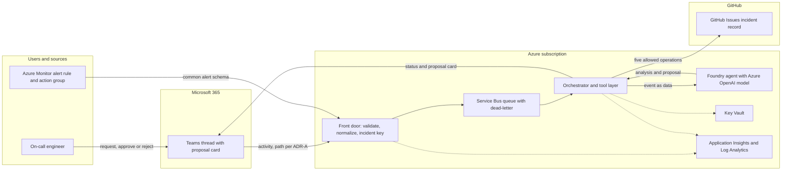

<!-- markdownlint-disable-file -->
# Architecture Design Plan: SRE Bot Managed Service MVP

> **DRAFT for human review.** This plan proposes architecture. It does not decide it. Decision authority stays with the named owners and with future ADRs. It does not authorize building, deploying, publishing, or transacting.
>
> - [ ] Reviewed and validated by a qualified human reviewer

| Field | Value |
|---|---|
| Date | 2026-11-23 |
| Session | sre-bot-managed-service |
| Status | Draft, not reviewed |
| Aligned to | [MVP implementation plan](../../plans/2026-11-23/sre-bot-managed-service-mvp-plan.md) phases P01 to P03 |
| Architecture notes (start here) | [sre-bot-managed-service-architecture-review.md](../../reviews/architecture/2026-11-23/sre-bot-managed-service-architecture-review.md). It holds the evidence table (E1 to E21), assumptions, findings and dispositions that this plan cites. |
| Architecture diagram | [sre-bot-managed-service-architecture-diagram.md](./sre-bot-managed-service-architecture-diagram.md). Mermaid view of the components, flows and proposed trust boundaries, with the rendered [image](../sre-bot-managed-service-architecture-diagram.png). |
| Requirements | [PRD v0.2.0](../../prd-sessions/sre-bot-managed-service-prd.md), [BRD v0.2.0](../../brd-sessions/sre-bot-managed-service-brd.md). Both are unreviewed drafts, and their quality gates are BLOCKED. |
| Experience draft | [map-journey.md](../../ux-artifacts/sre-bot-managed-service/on-call-incident-response/map-journey.md). It is partial and not validated user research. |
| Evidence boundary | Synthetic or public material only. The source deck is cited by slide. No real incident, customer or tenant data. |

Labels: **Fact** is stated by a cited source. **Proposed** is a design suggestion awaiting a human decision. **Assumption** is unverified. **Unknown** has no evidence. Evidence IDs (E#) are defined in the architecture notes.

## 1. What this plan covers

The implementation plan has three phases. This plan gives each one a solution approach, trade-offs, cloud architecture and Well-Architected concerns. It then covers Microsoft Marketplace and Microsoft 365 Copilot Agent Store publication, and whether Microsoft IQ matters.

Scope limits that shape everything below:

* The MVP accepts Teams requests and Azure Monitor alerts, analyses only the content supplied, proposes recovery and never executes it, and records the work in GitHub Issues (E1, E2).
* The MVP is shown locally (decision D7). What "locally" means is open (OQ-014 and OQ-016). Publication needs a hosted service, so the publication work here is readiness assessment only (plan decision D3).
* Positioning against Azure SRE Agent is deferred beyond the MVP (D7). Publication gates that depend on differentiation are therefore open, not solved.

## 2. Architecture invariants

These follow from the requirements and hold in every option below. They are the review criteria for any future design.

| ID | Invariant | Requirements | Enforced by (Proposed) |
|---|---|---|---|
| I1 | The service never carries out recovery. | FR-007, BR-004, AC-007 | No write permission on customer resources, and a tool allowlist. Not prompt wording alone. |
| I2 | Alert text, Teams text, logs and issue comments are data, never instructions. | NFR-003, AC-013 | Content isolated from instructions, structured output, server-side validation before any write. |
| I3 | Every request and action is recorded with who or what acted. | FR-009, NFR-002 | One write path (the tool layer) that always emits a structured audit entry. |
| I4 | A proposal without a decision is pending, never approved. | FR-008, AC-022 | State held on the incident record, default pending. |
| I5 | Only the two trigger types are accepted. | CON-001, FR-012 | One front door that rejects other types. |
| I6 | Analysis cites the event content it relies on and states missing context. | FR-006, FR-014, AC-006, AC-024 | Output schema with cited fields, checked against the payload. |
| I7 | Secrets never appear in code or on the incident record. | NFR-001, AC-011 | Key Vault and managed identity. A redaction step before any issue write. |

## 3. Target reference architecture

This is the target shape the deck describes, with the open choices marked. A local demonstration may collapse components (Section 4, P02).

### Components and responsibilities

| Component | Responsibility | Basis |
|---|---|---|
| Front door | Authenticate the sender, accept only the two trigger types, normalize to the standard event (source type, time received, original content), derive the incident key | FR-001 to FR-004, FR-012. Azure Monitor action groups can call an Azure Function with the common alert schema (E16). |
| Queue | Absorb bursts, retry, isolate poison messages | CON-005, NFR-009. Necessity for the MVP is open (see P02-T01). |
| Orchestrator and tool layer | Call the agent, validate its output, perform the only permitted writes to the incident record, emit audit entries, reply in Teams | I1 to I4, I6. The five operations are `create_issue`, `update_issue`, `add_comment` or `list_comments`, `get_issue`, `search_issues` (E2, PRD CON-007). |
| Foundry agent | Produce analysis and a recovery proposal from supplied content | CON-003 (E2). |
| Key Vault | Hold the GitHub credential and other secrets | NFR-001. |
| Telemetry | Health, latency and audit correlation | NFR-005, NFR-008. |

### Trust boundaries

* **TB1:** content from alerts, Teams, logs and comments is untrusted and enters only through the front door.
* **TB2:** model output is untrusted. The tool layer validates it before it causes any write.
* **TB3:** the GitHub credential is the only identity that writes the incident record, with the minimum scope.
* **TB4:** the service identity holds no write permission on customer Azure resources (I1).
* **TB5:** data published to Microsoft 365 and Teams is processed and stored under their terms (E9).

## 4. Phase architecture

### P01: Establish the evidence-backed MVP contract

**Solution approach (Proposed).** Treat P01 as contract-first. Produce no cloud resources. Fix the artifacts that every later phase depends on:

* the standard event shape (source type, time received, content as received) and the incident-key rule (OQ-005, OQ-006);
* the tool allowlist and the audit entry format (who or what acted, what the action was);
* the proposal state model (pending, approved, rejected);
* the architecture invariants in Section 2;
* the decision log (ADR candidates in Section 8).

**Cloud architecture.** None deployed. The deliverable is the reference architecture and trust boundaries in Section 3, reviewed by a human.

**Trade-offs.**

| Choice | Option A | Option B | Provisional lean |
|---|---|---|---|
| Event shape | Minimal (source, time, content) | Extract structured fields at ingest | A, until OQ-005 and OQ-015 supply real payload fields. B adds parsing risk and unverified assumptions. |
| Decision timing | Decide Teams path and agent shape now | Defer to P02 | Decide in P01 (ADR-A). It changes P02 and P03 effort. |

**Well-Architected concerns.**

| Pillar | Concern | Proposed response |
|---|---|---|
| Security | Threat model before build | Hand to the Security Planner for a full model. Cover prompt injection and excessive agency (E21). |
| Reliability | No targets are known | Define measurement points and leave targets `Unknown` (OQ-009). Do not invent numbers. |
| Cost optimization | Model and request budgets are unset | Make a per-incident token cap and an event size cap named parameters. Values `Unknown`. |
| Operational excellence | Decisions get lost | Record the four ADR candidates. Version the contract artifacts. |
| Performance efficiency | No latency budget | Name three timing points: accepted to acknowledged, accepted to analysis, accepted to proposal (M-01, NFR-008). |
| Responsible AI | AI disclosure, citation, feedback | Hand to the RAI Planner. Agent Store validation expects an AI label, citations and feedback for custom engine agents (E10). |

### P02: Deliver the grounded incident workflow

#### P02-T01: Handle and identify supported events

**Solution approach (Proposed).** One front door for both triggers. It validates the sender, rejects other types, normalizes, and derives a deterministic incident key from stable payload fields. It then enqueues the event. A deterministic key makes "the same input yields the same identification" testable (AC-004). Semantic matching would improve recall but is not repeatable.

**Cloud architecture.** Front door as an Azure Function with an HTTP trigger. Azure Monitor reaches it through an action group, which supports an Azure Function action and the common alert schema (E16). The queue sits between ingest and the worker.

**Trade-offs.**

| Choice | Option A | Option B | Provisional lean |
|---|---|---|---|
| Buffering | Queue between ingest and worker | Process inline | Queue for the target. GitHub limits and model throttling make bursts likely to fail inline (E17). A local demo may process inline (Assumption, OQ-014). |
| Recurrence lookup | `search_issues` per event | Keep an incident-key to issue-number map in a small store, with search as fallback | B is likely needed. GitHub search endpoints have stricter limits (E17), and the five-operation boundary does not forbid a separate store. Decide in ADR-C. |
| Incident key | Deterministic from payload fields | Model-assigned | A (AC-004). The field set is `Unknown` (OQ-006). |
| Trigger types | Allowlist at the front door | Filter downstream | Front door (I5, AC-021). |

**Well-Architected concerns.**

| Pillar | Concern | Proposed response |
|---|---|---|
| Reliability | Duplicate delivery and retries create duplicate records | Make the consumer idempotent on the incident key and event ID. Dead-letter poison events and alert on them. |
| Security | Spoofed alerts or messages | Authenticate senders. Prefer Microsoft Entra-secured action group delivery (secure webhook or Function authorization) over a shared secret in a URL (E16). |
| Performance efficiency | Search limits slow recurrence lookups | Use the map store. Measure lookup time. |
| Cost optimization | Per-event cost | Cap event size. Drop oversized content with a recorded notice rather than silently truncating. |
| Operational excellence | Hard to debug a lost event | Carry one correlation ID from front door to issue comment. |

#### P02-T02: Produce grounded analysis and a non-executing proposal

**Solution approach (Proposed).** The orchestrator sends the normalized event to the Foundry agent as data, with fixed instructions kept separate. The agent returns a structured result: analysis, the payload fields it relied on, missing context, and a proposed recovery. The orchestrator checks that every cited field exists in the payload before anything is written. Non-execution is enforced by permissions: the service identity has no write role on customer resources, and the only write tools are the five record operations.

**Cloud architecture.** Foundry project with an Azure OpenAI deployment (CON-003). Tools implemented in the tool layer, not given to the model as free-form endpoints. Managed identity for Azure access. GitHub credential from Key Vault.

**Trade-offs.**

| Choice | Option A | Option B | Provisional lean |
|---|---|---|---|
| Orchestration | Foundry agent with tool calling | Direct model call from the orchestrator | The deck names Foundry (CON-003). B is simpler to test and run locally, A gives versioning and publishing options (E9). Decide with ADR-A. |
| Output control | Free text | Structured schema with validated citations | Structured (I6). Free text cannot be checked against AC-006. |
| Latency | Wait for full analysis | Acknowledge fast, then stream or follow up | Acknowledge fast. Agent Store validation sets response-time bands (E10), though their applicability to this agent shape is unconfirmed. |

**Well-Architected concerns.**

| Pillar | Concern | Proposed response |
|---|---|---|
| Security | Prompt injection, excessive agency (E21) | I1 and I2. Test with instruction-like alert text (AC-013). |
| Reliability | Model throttling or unavailability | Queue and retry. State the limit to the engineer instead of presenting an unsupported result (FR-014). |
| Cost optimization | Token use grows with payload size | Per-incident token cap. Report tokens per incident in telemetry. Azure SRE Agent bills by usage with an always-on charge (E18), a reference for how customers may expect cost to be modelled, not a plan. |
| Performance efficiency | Model latency against Teams expectations | Acknowledge, then deliver. Measure the three timing points. |
| Operational excellence | Prompt or model changes alter behavior | Version the agent. Keep a fixed set of synthetic cases as a regression suite (P03-T01). |
| Responsible AI | Over-trust of a generated diagnosis | Show cited evidence, missing context and an AI label. Offer feedback (E10, E4). |

#### P02-T03: Record decisions and communicate status

**Solution approach (Proposed).** The incident record is the only state. The orchestrator is stateless. A proposal carries a state label (pending by default). The engineer approves or rejects from a Teams card. The tool layer then writes the decision, attributed to the engineer's identity, as a structured comment and a label update. Every bot action emits the same structured audit entry.

**Cloud architecture.** Teams reply path from the orchestrator. GitHub writes through the tool layer only. Application Insights for health and timing. Key Vault for the credential.

**Trade-offs.**

| Choice | Option A | Option B | Provisional lean |
|---|---|---|---|
| Approval surface | Teams card | Engineer comments or labels on the issue | A for flow, with the bot writing the attributed record. B is the fallback if identity mapping is not solved. Authority and identity are `Unknown` (OQ-010, OQ-012). |
| Audit format | Free text comments | Structured entry plus readable text | Structured plus text (NFR-002, AC-025). |
| Write frequency | One comment per action | Coalesce updates | Coalesce. Content-creation limits are about 80 a minute and 500 an hour, with secondary limits that can change without notice (E17). Illustration only: five writes per incident would reach 500 writes an hour at about 100 incidents an hour. The limit's scope is not fully verified. |

**Degraded behavior (Proposed, chosen behavior `Unknown`, OQ-009).**

| Failure | Proposed behavior |
|---|---|
| GitHub unavailable or throttled | Queue and retry with backoff, honoring rate-limit and retry-after headers (E17). Dead-letter after a limit. Tell the engineer in Teams that the record is delayed. |
| Teams unavailable | Record on the issue anyway. Retry the reply. |
| Queue unavailable | Fail closed with an alert. Do not process inline silently. |
| Model unavailable | Record the event, state that analysis is unavailable, and make no proposal. |
| Key Vault unavailable | Stop writing, and alert. Never fall back to a stored secret. |

**Well-Architected concerns.**

| Pillar | Concern | Proposed response |
|---|---|---|
| Reliability | NFR-009 behavior is undefined | Adopt the table above after human review. |
| Security | Approver identity (NFR-002, OQ-010) | Map the Teams user to a named approver list. Pending is never approval (AC-022). Provide an emergency stop (NFR-004). |
| Cost optimization | GitHub is the system of record | Coalesce writes. Estimate volume (OQ-009). |
| Operational excellence | Audit and health | Correlation ID, health signals (NFR-005), a documented stop procedure. |
| Performance efficiency | Time to proposal | Record timestamps so M-01 is computable (NFR-008, AC-018). |
| Privacy | Incident content on GitHub | A redaction step before any write. Private repository. The rule itself is `Unknown` (NFR-007, OQ-011). |

### P03: Prepare validation and publication-readiness evidence

#### P03-T01: Define validation and operational evidence

**Solution approach (Proposed).** A separate test environment: a synthetic alert generator, a test Teams tenant, a private test GitHub repository and an isolated Foundry project. No real incident, customer or tenant data (CON-004). Test classes follow the plan: grounded and ungrounded input, incomplete or misleading alerts, instruction-like text, rejected proposals, unavailable integrations, an alert burst against GitHub limits, and accessibility checks from the journey draft (E4).

**Cloud architecture.** The same components as Section 3 in a non-production resource group, with budgets and alerts on model and queue use. Queries and a workbook over Application Insights for M-01 to M-06.

**Trade-offs.**

| Choice | Option A | Option B | Provisional lean |
|---|---|---|---|
| Test data | Fully synthetic | Deidentified real incidents | A. Real incident data stays out of the repository (CON-004), and handling rules are open (OQ-011). |
| Evaluation | Manual review | Automated checks on citations and refusals plus manual review | Both. Citation validity and prompt-injection cases are automatable. |

**Well-Architected concerns.**

| Pillar | Concern | Proposed response |
|---|---|---|
| Reliability | Failure paths untested | Inject GitHub 403 and 429 responses, queue loss and model throttling. |
| Security | Injection and excessive agency | A fixed injection test set. Confirm no write path beyond the allowlist. |
| Operational excellence | Evidence without baselines | Compare with a manual baseline using the same synthetic incident (E4). Targets stay `Unknown` until set (OQ-002). |
| Cost optimization | Test spend | Budgets and alerts in the test environment. |
| Performance efficiency | Latency | Record the three timing points per run. |

#### P03-T02: Assess provisional publication readiness

This task is assessment only. See Section 5 for the full analysis. The architecture implication is that publication needs a hosted, always-available service with a defined tenancy model, none of which a local demonstration provides.

## 5. Publication architecture: Marketplace and Agent Store

Two things are easy to confuse and need separate decisions:

* **Distribution to Microsoft 365 Copilot and Teams users** (the agent surface): how the agent is packaged, found, installed and supported.
* **Commercial sale of the managed service** (the offer): offer type, pricing, billing and fulfilment.

The deck's "Managed Service" label risks a naming trap. Partner Center has an offer type called **Managed service**, which manages customer Azure resources through delegation (Azure Lighthouse) (E13). The MVP never touches customer Azure resources (I1), so that offer type does not obviously fit. This is an inference, not a decision.

### 5.1 Distribution routes

| Route | What it is | Evidence | Fit for this MVP |
|---|---|---|---|
| R0 Local demonstration only | No publication | Plan decision D3 | Current scope |
| R1 Share for testing | Share with selected testers. Foundry publishing with "Just you" scope needs no admin approval (E9). | E9, E11 | Possible for the workshop if the service is reachable. Not publication. |
| R2 Publish to the organization | Foundry "People in your organization" scope, with Microsoft 365 admin approval. It appears under "Built by your org" (E9). Reviewed through the Tools Registry or Agent Registry (E11). | E9, E11 | Plausible for an internal or pilot customer. |
| R3 Publish publicly through Microsoft Marketplace | A tested plugin package submitted in Partner Center. Each customer admin installs it, allows the publisher category and sets availability (E11, E12). | E11, E12 | Open. The documented public route covers plugin packages (skills, connectors, declarative agents). Whether a Foundry-published or custom engine agent can follow it was not established (limit L3). |
| R4 Commercial offer for the service | An offer type chosen in Partner Center. It cannot be changed after selection (E13). | E13, E14 | Open (OQ-013). Candidates: Software as a service, Professional service, Azure Application (managed application), Managed service (Lighthouse). Marketplace groups AI agents as Azure agents or Microsoft 365 agents (E14). |

**Agent shape (Proposed, no supported selection).** The repository guidance separates declarative agents (Microsoft 365 Copilot orchestrates), custom engine agents (publisher owns models and orchestration) and apps with an agent surface (E20). This MVP supplies its own model and orchestration (CON-003), which points toward a custom engine agent. Confidence is low to medium, and the choice belongs in ADR-A.

### 5.2 Agent Store readiness checklist

Requirements below come from the Agent Store validation guidelines and publishing guides. Applicability to the final agent shape is unconfirmed. "Gap" means this design does not yet satisfy the item.

**Packaging**

| Requirement | Evidence | Design implication | Status |
|---|---|---|---|
| Submit the exact validated package and version. Provide certification notes and test access through the supported channel, not source control. | E12 | Keep a release record per version. | Not started |
| App manifest 1.13 or later. For agents that operate in channels, new Teams Store submissions from July 2026 need schema 1.25 or later. | E10 | Pick the tooling that emits a current schema. | Not started |
| Name and description rules. No instructional phrases, URLs, emojis or hidden characters in descriptions or conversation starters. | E10 | Write listing text to these rules. | Not started |
| For custom engine agents, the bot must be connected to the Microsoft 365 and Teams channel, and the bot ID must match the manifest. | E10 | Depends on ADR-A. Foundry direct publishing registers the bot and compiles the manifest (E9). | Depends on ADR-A |

**Discoverability**

| Requirement | Evidence | Design implication | Status |
|---|---|---|---|
| Differentiated value beyond what Copilot offers (a *Must fix* item). | E10 | **Gap, high.** Positioning is deferred (D7) and no differentiation evidence exists. Overlap with Azure SRE Agent is documented (E18). | Gap |
| At least three prompt starters, all functional. Context-specific suggestions for custom engine agents. | E10 | Add as candidate requirements if the public route is pursued. | Gap |
| Work on Teams desktop and web, copilot.microsoft.com and Microsoft 365 Copilot in Word. | E10 | Adaptive card and reply design must be tested in these clients. | Not started |
| Customer admin must install, allow the publisher category and set availability. Publication alone does not make the agent visible. | E11 | Plan onboarding per customer. | Not started |

**Supportability**

| Requirement | Evidence | Design implication | Status |
|---|---|---|---|
| Support contact, privacy statement and terms, all reachable. An owner for certification responses, customer support, updates and retirement. | E12 | Owners are `Unknown`. | Gap |
| Response time bands (50 percent within 2 seconds, 75 percent within 5, 99 percent within 9) and 99.9 percent availability. | E10 | Applicability to this agent shape is unconfirmed. If they apply, they conflict with direct model latency, which favors acknowledge-then-deliver and a hosted, redundant service. A local demonstration cannot meet them. | Gap, to confirm |
| Observability traces for Blueprint ID and Agent ID, only if the agent is extended for Agent 365. | E10 | Not planned. Revisit only if Agent 365 is chosen. | Not applicable now |
| Graceful error handling and security sections of the guidelines. | E10 | Not read (limit L2). | Unassessed |

**Integration**

| Requirement | Evidence | Design implication | Status |
|---|---|---|---|
| AI label, feedback control, citations and streamed responses for custom engine agents. | E10 | Citations match FR-006. AI label, feedback and streaming are not in the PRD. | Gap |
| Explicit confirmation before consequential actions that change a system. | E10 | The service creates and updates issues. For a Teams request this may need a confirmation step. Applicability to a custom engine agent is unconfirmed. Alert-triggered writes have no user present. | Open |
| If single sign-on is used, list the Microsoft 365 client application IDs in the Entra app registration. If web content is embedded, set frame-ancestors headers. | E10 | Decide SSO in ADR-A. | Open |
| Azure Monitor alert delivery to the service. | E16 | Customer configures the action group (OQ-015). The alert-triggered path is a backend service. A Store package covers only the Teams conversation. | Open |
| A GitHub credential per customer. Rate limits depend on the authentication method, and a GitHub App installation has its own limit. | E17 | Multi-tenant operation needs per-customer credentials and isolation. The best-fit credential type is not verified here. | Open |
| Published agents cause Microsoft 365 and Teams to process and store certain data, subject to their terms and residency. Projects with public network access disabled need the REST route. | E9 | Data flow and residency review before any publish. | Open |

### 5.3 Marketplace offer-type options (R4)

Revenue model, price and channel are `Unknown` (OQ-013), and the shared monetization plan does not exist. This table is a starting point for the Product Manager, not a recommendation.

| Option | What it would mean here | Fit signals | Concern |
|---|---|---|---|
| Software as a service | Publisher-hosted, customer subscribes | The service is software the publisher operates (E13) | Needs a tenancy model, subscription lifecycle and entitlement handling (E20) |
| Professional service | A scoped engagement, such as setup or workshop | Matches the workshop context | Not the recurring operated service |
| Azure Application (managed application) | Deployed into the customer's subscription | Keeps data in the customer's tenant | Customer deployment burden and management-fee boundary (E20) |
| Managed service (Lighthouse delegation) | Publisher manages delegated customer Azure resources | Fits only if the service later acts on customer Azure resources | The MVP deliberately does not (I1) |

### 5.4 Publication readiness gates (no dates)

1. The agent shape and Teams path are decided (ADR-A).
2. Positioning and differentiation evidence exist (OQ-008, now deferred).
3. A hosted environment and tenancy model are decided (OQ-014, OQ-016, ADR-D).
4. The offer type and monetization plan exist (OQ-013, owned by the Marketplace publishing workflow).
5. Publisher enrollment and verification are confirmed by an administrator in Partner Center.
6. Security, privacy, accessibility and Responsible AI reviews are done by their owners. A package check does not replace them (E20).
7. A human release decision. Submission, certification and publication are separate outcomes (E11).

## 6. Microsoft IQ assessment

Microsoft IQ is described as an enterprise intelligence layer with four capabilities: Work IQ (how people work), Fabric IQ (business state and rules), Foundry IQ (curated institutional knowledge) and Web IQ (web intelligence) (E15).

**Result: relevant later, not an MVP dependency.** No requirement, constraint or evidence in this session calls for it. The MVP boundary, analysis from the supplied alert or message only (D6), excludes the retrieval these capabilities provide.

| Capability | Possible relevance | Effect on the MVP boundary | Disposition |
|---|---|---|---|
| Foundry IQ | The most natural fit. It could ground analysis in runbooks, SOPs and policies, which the workshop evidence plan anticipates. | Contradicts payload-only analysis. Needs a decision to revisit D6, plus a new citation source type and access rules. | Defer. Candidate for a later phase. |
| Work IQ | Team and on-call context from Microsoft 365, and the Copilot summary ideas in the journey draft (E4). | Retrieval beyond the supplied content. Needs permission-aware access and data-residency review. | Defer. |
| Fabric IQ | Business entities and rules. | No evidence that the customer uses Fabric or models incidents as business entities. | Not relevant now. |
| Web IQ | External web grounding. | Brings external untrusted content into incident analysis, which raises injection risk (I2). | Not recommended without a separate decision. |

Not verified: availability, licensing, pricing and admin controls for each capability, and whether any has a bearing on Marketplace or Agent Store review. The pages read were a hub overview, so no requirement is inferred.

## 7. Assumptions and open questions

| ID | Item | Type | Owner | Effect |
|---|---|---|---|---|
| AQ-1 | "Shown locally" means local components, or Azure services demonstrated locally (OQ-014, OQ-016). | Open | SME | Decides whether the queue and Foundry agent are used in the demo. |
| AQ-2 | A locally hosted Teams path needs a publicly reachable HTTPS endpoint. | Assumption (E9 describes channel delivery over HTTPS to the agent's route, not local options) | Engineering | Demo setup. |
| AQ-3 | Agent shape and Teams path (ADR-A). | Open | Product owner, engineering | Packaging, publishing route, resource count. |
| AQ-4 | Where the incident-key map lives, or whether search alone suffices (ADR-C). | Open | Engineering | Recurrence reliability against search limits. |
| AQ-5 | Approver authority and identity mapping (OQ-010, OQ-012). | Open | Security, SME | FR-008, I4. |
| AQ-6 | Classification, redaction and retention (OQ-011). | Open | Security, owner | NFR-007, issue content. |
| AQ-7 | Tenancy model: one deployment per customer, or a multi-tenant service. | Open | Product owner | Offer type, credentials, isolation. |
| AQ-8 | Whether the validation response-time and availability bands apply to this agent shape. | Open | Publishing owner | Latency design and hosting. |
| AQ-9 | Whether a Foundry-published or custom engine agent can use the public Marketplace route. | Open | Publishing owner | R3. |
| AQ-10 | Publisher account enrollment, verification and roles. | Unknown | Partner Center admin | Gate 5. |
| AQ-11 | Whether the consequential-action confirmation rule applies to issue writes. | Open | Publishing owner | Teams request flow. |
| AQ-12 | Alert volumes, latency and availability expectations (OQ-009). | Open | SME | Queue sizing, cost, GitHub limits. |

## 8. Traceability and decisions

### Plan tasks to architecture

| Plan task | Architecture sections | Main requirements |
|---|---|---|
| P01-T01 | Section 2, Section 3, P01 | FR-006 to FR-010, FR-013, FR-014, NFR-002, NFR-003, NFR-006, NFR-009 |
| P02-T01 | P02-T01 | FR-001 to FR-005, FR-011, FR-012, NFR-008, NFR-010 |
| P02-T02 | P02-T02 | FR-006, FR-007, FR-014, NFR-003, NFR-004, NFR-006 |
| P02-T03 | P02-T03 | FR-008 to FR-010, FR-013, NFR-001, NFR-002, NFR-005, NFR-007, NFR-009 |
| P03-T01 | P03-T01 | NFR-003, NFR-005, NFR-006, NFR-008, NFR-009, NFR-010 |
| P03-T02 | Section 5, Section 6 | NFR-001, NFR-004, NFR-005, NFR-007, NFR-010 |

### Planned ADRs (not created)

These are planned records for human decision owners. Nothing here is decided. The approved root is `docs/planning/adrs/`.

| Planned ADR | Decision | Why it is significant |
|---|---|---|
| ADR-A | Teams and Copilot path and agent shape: Foundry-native endpoint, Bot Service plus a front door (the deck's shape), or a declarative agent | Changes packaging, resource count, publishing route and where guards live. |
| ADR-B | Agent identity and permission model, and how non-execution is enforced | Security-critical invariant I1. |
| ADR-C | Ingestion buffering, incident key and mapping store | Reliability against GitHub limits. |
| ADR-D | Publication route, tenancy and offer type | Offer type cannot be changed after selection (E13). |

## 9. Next steps for human owners

1. Review this plan and the architecture notes. Leave the review boxes unchecked until a person completes them.
2. Answer AQ-1 (what "shown locally" means) and AQ-3 (agent shape and Teams path), since they set the most downstream effort.
3. Hand the security items (threat model, identity, injection) to the Security Planner, and the AI disclosure items to the RAI Planner.
4. Ask the Product Manager to start the shared monetization plan using the Marketplace publishing workflow, once OQ-013 has an owner.
5. When ADR-A to ADR-D have owners, use ADR Creator to draft them from the architecture notes.
