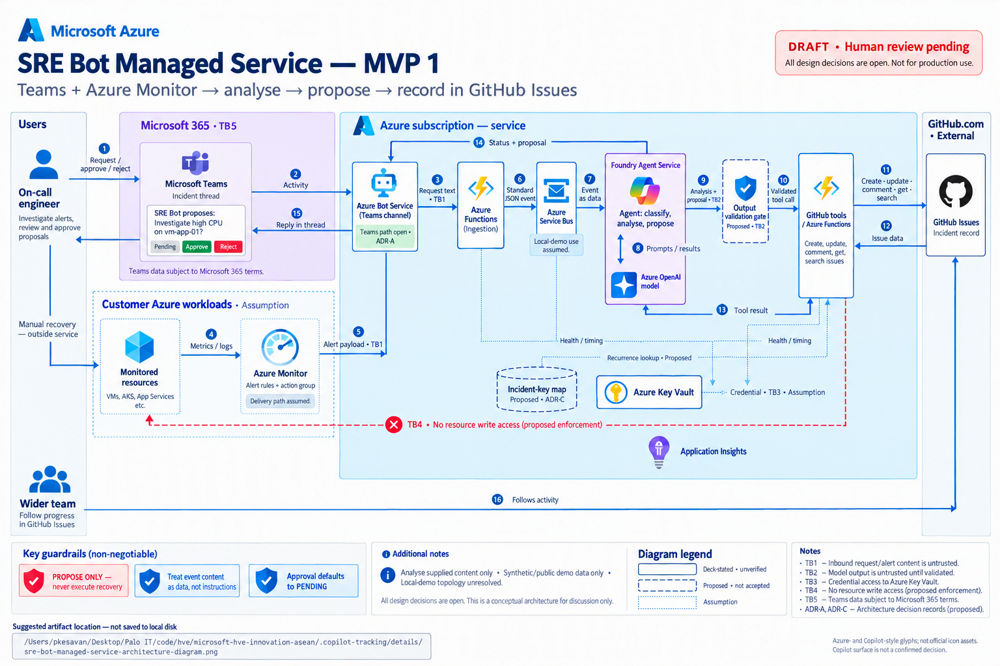

<!-- markdownlint-disable-file -->
# SRE Bot MVP Architecture

> **DRAFT for human review.** This is a view over the existing artifacts, not a source of authority. It shows what the deck states, what the architecture notes propose and what is still assumed. Nothing here is a confirmed decision, and the review checkboxes are unchecked.
>
> - [ ] Reviewed and validated by a qualified human reviewer

| Field | Value |
|---|---|
| Date | 2026-11-23 |
| Session | sre-bot-managed-service |
| Architecture notes | [sre-bot-managed-service-architecture-review.md](../../reviews/architecture/2026-11-23/sre-bot-managed-service-architecture-review.md) |
| Architecture design plan | [sre-bot-managed-service-architecture-design-plan.md](./sre-bot-managed-service-architecture-design-plan.md) |
| Implementation plan | [sre-bot-managed-service-mvp-plan.md](../../plans/2026-11-23/sre-bot-managed-service-mvp-plan.md) |
| Requirements | [PRD v0.2.0](../../prd-sessions/sre-bot-managed-service-prd.md), [BRD v0.2.0](../../brd-sessions/sre-bot-managed-service-brd.md). Unreviewed drafts. |
| Experience draft | [map-journey.md](../../ux-artifacts/sre-bot-managed-service/on-call-incident-response/map-journey.md). Partial, not validated research. |
| Output root | `.copilot-tracking/details/`, the approved architecture root in the session context |

## Architecture image

* Image: [sre-bot-managed-service-architecture-diagram.png](../sre-bot-managed-service-architecture-diagram.png), stored one level up in `.copilot-tracking/details/`. It is the image supplied for human review and replaces an earlier author-drawn version.
* Review state: the image is marked "Draft, human review pending". No human reviewer has signed it off here, and the review checkbox at the top of this file stays unchecked.
* The image states that its glyphs are not official icon assets and that the Copilot surface is not confirmed. The Teams path and agent shape are open (ADR-A).
* The image footer contains a local absolute file path. Remove it before the image is shared outside the team.
* The image and the Mermaid diagram below should show the same components and flows. If they differ, correct the Mermaid source in this file first, then update the image.

## What "confirmed design" means here

No architecture decision is confirmed. The architecture notes record every recommendation as deferred pending human review, and the four planned ADRs do not exist. The diagram therefore draws:

* **Deck:** components and flows the source deck states (evidence C3 slides 4 to 6, through the research artifacts). The deck itself is outside the workspace and was not re-read, so these are unverified.
* **Proposed:** elements from the architecture design plan that no one has accepted.
* **Assumption:** elements with no direct evidence.

Nothing was added that appears in none of these sources.

## SRE Bot MVP Architecture

```mermaid
flowchart LR
    accTitle: SRE Bot MVP architecture with trust boundaries and evidence status
    accDescr: An on-call engineer and Azure Monitor alerts reach an ingestion function, a queue, and a Foundry agent whose output is checked before five GitHub Issues operations record the incident. Replies return to the Teams thread. Dashed items are proposed and dotted items are assumptions. The service has no write access to monitored resources.
    subgraph users["Users"]
        eng["On-call engineer - deck"]
        team["Wider team - deck - follows the issue"]
    end
    subgraph m365["Microsoft 365 - TB5 data processed and stored under Microsoft 365 and Teams terms"]
        teams["Microsoft Teams thread - deck"]
    end
    subgraph cust["Customer Azure workloads - assumption"]
        res["Monitored resources"]
        mon["Azure Monitor alert rules and action group - deck"]
    end
    subgraph az["Azure subscription: the service"]
        bot["Azure Bot Service Teams channel - deck - path open ADR-A"]
        ing["Azure Functions ingestion - standard JSON event - deck"]
        sb["Azure Service Bus - deck - use in local demo is an assumption"]
        subgraph fa["Foundry Agent Service - deck"]
            agent["Agent: classify, analyse, propose"]
            llm["Azure OpenAI model - deck"]
        end
        val["Output validation gate - proposed - TB2"]
        tools["GitHub tools as Azure Functions - five operations - deck"]
        map[("Incident-key map - proposed - ADR-C")]
        kv["Key Vault - deck - holds GitHub credential is an assumption"]
        ai["Application Insights - deck"]
    end
    subgraph gh["GitHub.com - external"]
        issues[("GitHub Issues incident record - deck")]
    end
    eng -->|"1 request, approval or rejection"| teams
    teams -->|"2 activity"| bot
    bot -->|"3 request text - untrusted - TB1"| ing
    res -->|"4 metrics and logs"| mon
    mon -->|"5 alert payload - untrusted - TB1 - delivery path is an assumption"| ing
    ing -->|"6 standard event"| sb
    sb -->|"7 event as data"| agent
    agent <-->|"8 prompts and results"| llm
    agent -->|"9 analysis and proposal - untrusted - TB2"| val
    val -->|"10 validated tool call"| tools
    tools -->|"11 create, update, comment, get, search"| issues
    issues -->|"12 issue data"| tools
    tools -->|"13 tool result"| agent
    agent -->|"14 status and proposal reply"| bot
    bot -->|"15 reply in thread"| teams
    teams --> eng
    issues -->|"16 follows activity"| team
    tools -.->|"credential - TB3 - assumption"| kv
    tools -.->|"recurrence lookup - proposed"| map
    ing -.->|"health and timing"| ai
    agent -.->|"health and timing"| ai
    eng -->|"carries out any recovery - outside the service"| res
    tools -.-x|"no write access - TB4 - proposed"| res

    classDef deck stroke-width:2px
    classDef proposed stroke-dasharray:6 4,stroke-width:2px
    classDef assumed stroke-dasharray:2 3,stroke-width:2px
    class eng,team,teams,mon,bot,ing,sb,agent,llm,tools,kv,ai,issues deck
    class val,map proposed
    class res assumed
```

### Legend

| Mark | Meaning |
|---|---|
| Solid outline, label ends "deck" | Stated by the source deck (C3 slides 4 to 6), unverified |
| Dashed outline, label says "proposed" | Proposed in the architecture design plan, not accepted |
| Dotted outline, or label says "assumption" | No direct evidence |
| Solid arrow with a number | Data flow, listed in the table below |
| Dotted arrow | Supporting or optional relationship |
| Dotted arrow ending in a cross | Access the service must not have |
| TB1 to TB5 | Trust boundaries from the design plan. They are proposed, because the deck documents none. |

## Key data flows

| # | Flow | Data | Basis |
|---|---|---|---|
| 1 | Engineer to Teams | Request, and any approval or rejection | Deck for the request. The approval mechanism is an assumption (OQ-010, OQ-012). |
| 2, 3 | Teams to Bot Service to ingestion | Teams activity, request text | Deck. The Teams path is open (ADR-A). |
| 4, 5 | Resources to Azure Monitor to ingestion | Metric and log alerts through an action group, alert payload | Deck names the action group. A direct Function action is a snippet-level fact (E16), and the exact delivery path is an assumption (OQ-015). |
| 6, 7 | Ingestion to Service Bus to agent | Standard JSON event: source type, time received, content as received | Deck. The event fields are proposed (FR-003). |
| 8 | Agent and model | Prompts and results | Deck. |
| 9, 10 | Agent to validation to tools | Analysis, cited fields, proposal. Validated before any write. | Validation gate proposed (I2, I6). |
| 11, 12, 13 | Tools to GitHub Issues and back | Five operations: `create_issue`, `update_issue`, `add_comment` or `list_comments`, `get_issue`, `search_issues` | Deck (CON-007). |
| 14, 15 | Agent to Bot Service to Teams thread | Status, analysis, proposal | Deck says the agent replies in the thread. A proposal card is proposed. |
| 16 | GitHub Issues to wider team | Shared record | Deck ("the whole team stays aware"). |
| n/a | Engineer to monitored resources | Any recovery, carried out manually | Decision D6. Outside the service. |

## Trust boundaries (proposed)

The deck documents no trust boundary. These come from the design plan (section 3) and the requirements. Each is a proposal for human review.

| ID | Boundary | Where on the diagram | Requirement basis |
|---|---|---|---|
| TB1 | Alert and Teams content is untrusted data and enters only through ingestion | Flows 3 and 5 | NFR-003, AC-013 |
| TB2 | Model output is untrusted and is validated before any write | Flow 9 and the validation gate | I2, I6, FR-006 |
| TB3 | One GitHub credential writes the incident record, with minimum scope | Tools to Key Vault | NFR-001, NFR-004 |
| TB4 | The service identity has no write permission on customer resources | Dotted arrow to monitored resources | FR-007, BR-004, I1 |
| TB5 | Data published to Microsoft 365 and Teams is processed and stored under their terms | Microsoft 365 boundary | E9 |

## Assumptions and open details

| ID | Detail | Effect on the diagram | Owner |
|---|---|---|---|
| D-1 | What "shown locally" means (OQ-014, OQ-016) | The queue and Foundry agent may be collapsed or replaced in a local demo. The diagram shows the target shape. | SME |
| D-2 | Teams path: Bot Service plus ingestion (drawn, matches the deck), or a Foundry-native endpoint (ADR-A) | The Bot Service node and flows 2 and 3 would change. | Product owner, engineering lead |
| D-3 | Whether Key Vault holds the GitHub credential | The credential edge is dotted. | Engineering lead |
| D-4 | Incident-key map store (ADR-C) | The node may be removed if search alone suffices. | Engineering lead |
| D-5 | How an approval or rejection reaches the record | Drawn through flows 1 to 3 and 11. The mechanism is unspecified. | Security, SME |
| D-6 | Whether the monitored workloads belong to the customer, and how alerts are delivered | The customer boundary and flow 5 are assumptions. | SME |
| D-7 | Tenancy and hosting model for publication (ADR-D) | One deployment is drawn. Multi-tenant is not shown. | Product owner |

## Deliberately not drawn

* **Log retrieval from Azure.** The MVP analyses only the supplied alert or message (D6). No data source for logs exists.
* **Marketplace, Partner Center and Agent Store.** Publication is assessment only (plan decision D3). They are covered in the design plan, section 5.
* **Microsoft IQ.** Not an MVP dependency (design plan, section 6).
* **Later phases:** file uploads, on-prem and SNMP alerts, scheduled jobs, AWS and GCP events, email and web intake, non-Azure models, and recovery without approval.
* **Jira.** Replaced by GitHub Issues (D4).
* **Platform administrators, security reviewers and the managed-service operator.** Only assumed as personas in the requirements, so they are not drawn as users.
* **Dead-letter handling, retries and the failure-behavior table.** Proposed in the design plan and left out to keep the diagram readable.

## Limits

* Built from the architecture notes and requirements, which are unreviewed drafts with blocked quality gates.
* The deck was not re-read. Deck-labelled elements rely on the earlier research.
* Diagram syntax was validated. It was not rendered and checked in a viewer.
* Nothing was built, deployed or tested.
