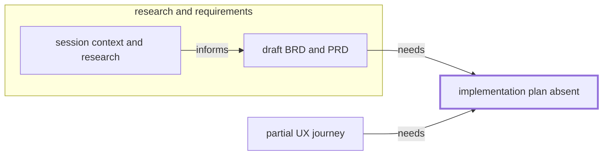
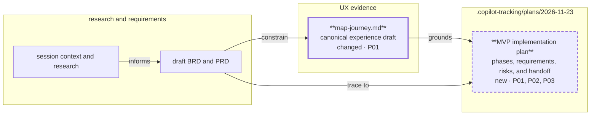

<!-- markdownlint-disable-file -->
# RPI Plan: SRE Bot Managed Service MVP

## Task Metadata

* Task ID: `sre-bot-managed-service-mvp`
* Task slug: `sre-bot-managed-service-mvp`
* Plan date: `2026-11-23`

## Executive Summary

* Bottom line: Plan a workshop-scoped SRE Bot MVP that accepts Teams requests and Azure Monitor alerts, grounds analysis in supplied content, cites its evidence, proposes but never executes recovery, and records the workflow in GitHub Issues.
* Why this matters: It gives an on-call engineer a focused path from signal to informed decision while preserving human control and an auditable handoff.
* Planning result: Complete as a lightweight implementation plan; implementation and publication are explicitly out of scope.
* Confidence and uncertainty: Triggers, payload-only analysis, human-controlled recovery, and the GitHub audit trail are evidence-backed. Customer, buyer, baseline, approval authority, matching, redaction, and publication feasibility remain unresolved.

### What You May Not Know

* [map-journey.md](../../ux-artifacts/sre-bot-managed-service/on-call-incident-response/map-journey.md) is the canonical experience draft. It is partial and not validated user research.
* The BRD and PRD are drafts with unchecked human-review items and unknown success targets.
* The source deck is confidential internal evidence cited by filename and slide; it is not copied into the repository.

## Phase Checklist

### Before

### After

The existing evidence constrains the canonical experience draft and the new plan. The plan turns those artifacts into phased implementation work without claiming implementation or publication readiness.

<!-- rpi:phase id=P01 -->
### [ ] P01: Establish the evidence-backed MVP contract

Goals:
* Establish one bounded user job, supported triggers, payload-only analysis, human-controlled recovery, traceability, and explicit uncertainty.

Dependencies:
* Draft BRD, PRD, research, and UX artifacts are available.

Changes in the map: Connect the canonical experience draft to the requirements and plan.

<!-- rpi:task id=P01-T01 -->
#### [ ] P01-T01: Confirm the primary user journey and constraints

Goals:
* Provide a reviewable experience contract for the on-call engineer that distinguishes evidence, generated analysis, unknowns, decisions, and failure states.

Requirements:
* Cite `FR-006`, `FR-007`, `FR-008`, `FR-009`, `FR-010`, `FR-013`, `FR-014`, `NFR-002`, `NFR-003`, `NFR-006`, and `NFR-009`.
* Preserve the boundary that only Teams and Azure Monitor triggers are accepted, analysis uses supplied content, and the service does not execute recovery.

Details:
* Use the canonical journey map and existing research; do not convert reported or assumed experience into validated findings.
* Keep accessibility and responsible-AI needs as validation requirements.

References:
* [map-journey.md](../../ux-artifacts/sre-bot-managed-service/on-call-incident-response/map-journey.md): journey, boundaries, and validation priorities.
* [sre-bot-managed-service-prd.md](../../prd-sessions/sre-bot-managed-service-prd.md): draft product requirements and acceptance criteria.

Dependencies:
* None.

<!-- rpi:phase id=P02 -->
### [ ] P02: Deliver the grounded incident workflow

Goals:
* Establish a testable path from accepted event through incident identification, analysis, proposal review, decision recording, and status reporting while preserving human control.

Dependencies:
* P01 establishes the experience boundary and evidence distinctions.

Changes in the map: Define the phased workflow represented by the implementation plan.

<!-- rpi:task id=P02-T01 -->
#### [ ] P02-T01: Handle and identify supported events

Goals:
* Give the service one consistent representation and incident identity for Teams requests and Azure Monitor alerts, including recurrence handling.

Requirements:
* Cite `FR-001`, `FR-002`, `FR-003`, `FR-004`, `FR-005`, `FR-011`, `FR-012`, `NFR-008`, and `NFR-010`.
* Satisfy the related acceptance criteria `AC-001` through `AC-005`, `AC-018`, `AC-020`, and `AC-021`, subject to decisions for unknown matching and timing rules.

Details:
* Keep the event minimum to source type, received time, and original content until `OQ-005` is resolved.
* Do not accept later-scope channels such as email, web, AWS, GCP, or on-prem alerts.

References:
* [sre-bot-managed-service-prd.md](../../prd-sessions/sre-bot-managed-service-prd.md): event, identity, recurrence, and trigger requirements.
* [sre-bot-managed-service-context-summary.md](../../research/2026-11-23/sre-bot-managed-service-context-summary.md): supported triggers and evidence boundary.

Dependencies:
* P01-T01.

<!-- rpi:task id=P02-T02 -->
#### [ ] P02-T02: Produce grounded analysis and a non-executing proposal

Goals:
* Let an engineer review analysis that names supplied evidence and uncertainty, then review a recovery proposal that cannot execute automatically.

Requirements:
* Cite `FR-006`, `FR-007`, `FR-014`, `NFR-003`, `NFR-004`, and `NFR-006`.
* Satisfy `AC-006`, `AC-007`, `AC-012`, `AC-013`, and `AC-024`.

Details:
* Treat alert and message content as untrusted input; instruction-like text is data, not authority.
* Show missing context rather than inventing a root cause or unsupported recovery.
* Keep recovery execution with the engineer and outside this MVP.

References:
* [sre-bot-managed-service-prd.md](../../prd-sessions/sre-bot-managed-service-prd.md): analysis, proposal, uncertainty, and guardrails.
* [map-journey.md](../../ux-artifacts/sre-bot-managed-service/on-call-incident-response/map-journey.md): interaction states and workflow boundaries.

Dependencies:
* P02-T01.

<!-- rpi:task id=P02-T03 -->
#### [ ] P02-T03: Record decisions and communicate status

Goals:
* Make the engineer's approval or rejection, every bot action, and each user-visible status traceable in the incident record and Teams thread.

Requirements:
* Cite `FR-008`, `FR-009`, `FR-010`, `FR-013`, `NFR-001`, `NFR-002`, `NFR-005`, `NFR-007`, and `NFR-009`.
* Satisfy `AC-008` through `AC-011`, `AC-014` through `AC-017`, `AC-019`, `AC-022`, `AC-023`, and `AC-025`.

Details:
* Pending proposals remain pending; rejection never becomes approval.
* Keep secrets out of code and records, identify actor and action, and make integration failure observable.
* Resolve approver authority, retention, redaction, and retry behavior before production implementation.

References:
* [sre-bot-managed-service-prd.md](../../prd-sessions/sre-bot-managed-service-prd.md): audit, decision, accessibility, observability, and failure requirements.
* [sre-bot-managed-service-brd.md](../../brd-sessions/sre-bot-managed-service-brd.md): business rules and traceability requirements.

Dependencies:
* P02-T02.

<!-- rpi:phase id=P03 -->
### [ ] P03: Prepare validation and publication-readiness evidence

Goals:
* Establish evidence for usefulness, safety, accessibility, operations, and provisional Marketplace or Agent Store fit without claiming approval or commercial readiness.

Dependencies:
* P02 defines the workflow and unresolved control choices.

Changes in the map: Add validation and provisional publication-readiness work to the plan.

<!-- rpi:task id=P03-T01 -->
#### [ ] P03-T01: Define validation and operational evidence

Goals:
* Make it possible to compare the MVP with a manual baseline and verify grounded responses, human control, failure handling, accessibility, and auditability.

Requirements:
* Cite `NFR-003`, `NFR-005`, `NFR-006`, `NFR-008`, `NFR-009`, and `NFR-010`.
* Cover synthetic alerts, incomplete or misleading input, rejected proposals, unavailable integrations, keyboard, screen reader, zoom, status announcements, and error recovery.

Details:
* Use synthetic alerts and an approved test Teams workspace and GitHub repository.
* Establish baselines and targets before claiming reduced checking or faster understanding.

References:
* [map-journey.md](../../ux-artifacts/sre-bot-managed-service/on-call-incident-response/map-journey.md): proposed validation plan and evidence-of-success measures.
* [sre-bot-managed-service-prd.md](../../prd-sessions/sre-bot-managed-service-prd.md): draft acceptance criteria and unknown targets.

Dependencies:
* P02-T03.

<!-- rpi:task id=P03-T02 -->
#### [ ] P03-T02: Assess provisional publication readiness

Goals:
* Produce a reviewable list of Marketplace and Microsoft 365 Copilot Agent Store assumptions, required evidence, and unresolved tenant or Partner Center checks without publishing.

Requirements:
* Cite `NFR-001`, `NFR-004`, `NFR-005`, `NFR-007`, and `NFR-010`.
* Keep publication claims provisional until current Microsoft guidance, Partner Center state, tenant feasibility, identity, permissions, data handling, packaging, and review requirements are verified.

Details:
* Treat the workshop-local demonstration as distinct from commercial launch readiness.
* Record overlap with Azure SRE Agent as an open positioning question; do not claim differentiation.

References:
* [sre-bot-managed-service-session-context.md](../../research/2026-11-23/sre-bot-managed-service-session-context.md): output roots and evidence boundary.
* [sre-bot-managed-service-brd.md](../../brd-sessions/sre-bot-managed-service-brd.md): publication and commercial unknowns.

Dependencies:
* P03-T01.

## User Decisions and Requirements

### Confirmed User Direction

* Continue `/rpi-plan` from the Project Management track.
* Use the existing `map-journey.md` as the experience draft; do not create a duplicate.
* Scope the plan to one evidence-backed MVP user job with grounded responses, source citations, permission-aware retrieval, clear uncertainty, human escalation, and confirmation before external actions.
* Do not implement production changes or publish anything.

### Planning Decisions and Feedback

| Group | Decision or feedback item | Status | Owner | Rationale or input needed | Evidence | Planning impact |
|---|---|---|---|---|---|---|
| D1 | Use on-call incident triage and recovery decision as the first MVP job. | confirmed | user and evidence | It is the only primary user and workflow supported by the artifacts. | context summary, BRD, PRD, UX map | P01–P03 |
| D2 | Keep recovery execution manual and require an engineer decision. | confirmed | user and evidence | This is the recorded MVP control boundary. | context D6; BRD/PRD DD-001 | P02-T02, P02-T03 |
| D3 | Keep publication readiness provisional and do not publish. | confirmed | user and evidence | Partner Center, tenant feasibility, and current guidance are not verified. | session context; BRD/PRD | P03-T02 |
| D4 | Resolve approver authority, incident matching, redaction, retention, and success targets before production implementation. | unresolved | downstream owners | Supplied artifacts mark these as unknown and implementation-impacting. | BRD and PRD open questions | P02-T01, P02-T03, P03-T01 |

## Planning Readiness and Next Step

| Field | Record |
|---|---|
| Planning execution and readiness | Complete / Not ready for production implementation; ready as a workshop handoff with explicit unresolved controls. |
| Decision participation | `agent-owned` ordinary synthesis; confirmed user direction is authoritative. |
| Blockers | No blocker to the workshop plan; production readiness is blocked by D4 and human review of draft artifacts. |
| Latest critique | `pending` until the required standard critique completes. |
| Relevant research | [sre-bot-managed-service-context-summary.md](../../research/2026-11-23/sre-bot-managed-service-context-summary.md) and [sre-bot-context-discovery-research.md](../../research/2026-11-23/sre-bot-context-discovery-research.md). |
| Plan | `.copilot-tracking/plans/2026-11-23/sre-bot-managed-service-mvp-plan.md` |
| Changes-record role | `.copilot-tracking/changes/2026-11-23/sre-bot-managed-service-mvp-changes.md` will be implementation evidence if authorized. |
| Continuation owner | User/manual RPI. |
| Required gates or confirmations | Human review of source requirements and UX map; resolution of D4; standard critique. |
| Next action | Complete the standard critique, resolve blockers, then use `/rpi-implement` only after human review and D4 decisions. |

## Goals

* Reduce avoidable incident-context gathering while preserving engineer control.
* Make evidence, generated analysis, uncertainty, and decisions distinguishable.
* Maintain a reliable, auditable incident record across Teams and GitHub Issues.
* Establish validation and publication-readiness evidence without overstating readiness.

## Scope and Non-Goals

### In Scope

* Teams requests and Azure Monitor alerts.
* Standard event representation, incident identification, grounded analysis, source citations, recovery proposal, engineer decision, status reporting, and GitHub Issue audit trail.
* Synthetic validation, accessibility checks, operational failure cases, and provisional publication-readiness assessment.

### Non-Goals

* Automatic recovery or approval bypass.
* Additional log retrieval, file uploads, screenshots, email/web intake, AWS/GCP/on-prem alerts, scheduled jobs, or non-Azure/local LLMs.
* Creating tracker issues during planning.
* Marketplace or Microsoft 365 Copilot Agent Store publication.

## Functional Requirements

* FR-001: Accept an engineer request in Teams.
* FR-002: Accept an Azure Monitor alert.
* FR-003: Normalize accepted events with source, received time, and original content.
* FR-004: Identify incidents consistently and recognize recurrence.
* FR-005: Create an incident record when none exists.
* FR-006: Produce analysis from supplied event content with citations.
* FR-007: Propose recovery for review without executing it.
* FR-008: Record approval or rejection; pending is never approval.
* FR-009: Record every request and bot action on the incident record.
* FR-010: Report status and results in the originating Teams thread.
* FR-011: Link recurring incidents to an existing record.
* FR-012: Reject unsupported trigger types in the MVP.
* FR-013: Record rejection and treat no recovery as approved.
* FR-014: State failures or insufficient information without unsupported results.

## Non-Functional Requirements

* NFR-001: Keep credentials and secrets out of code and incident records.
* NFR-002: Identify who or what acted and what action occurred.
* NFR-003: Treat alert, message, log, and comment content as untrusted input.
* NFR-004: Limit service permissions and provide an emergency stop.
* NFR-005: Provide health and operational telemetry.
* NFR-006: Preserve meaning without color or images and support accessible interaction states.
* NFR-007: Apply an approved classification and redaction rule.
* NFR-008: Make elapsed event-to-proposal timing readable; target remains unknown.
* NFR-009: Make unavailable or throttled integrations observable and safe.
* NFR-010: Verify the declared Teams, Azure Monitor, and GitHub integrations.

## Risks and Open Questions

| Priority | Type | Risk, question, or planning item | Affected work | Impact | Smallest action or evidence needed | Owner |
|---|---|---|---|---|---|---|
| H | open question | Who is the buyer, sponsor, and authorized approver? | P02-T03, P03-T02 | Governance and publication cannot be claimed. | Name owners and approval authority. | Product owner |
| H | open question | What minimum payload and incident-matching rule are required? | P02-T01, P02-T02 | Duplicate records or weak analysis. | Define synthetic payload fixtures and matching decision. | SME and engineering |
| H | risk | Instruction-like content may manipulate analysis or proposed actions. | P02-T02 | Unsafe or overconfident recovery. | Adversarial tests and explicit untrusted-input handling. | Security and engineering |
| H | open question | What redaction, retention, visibility, and notification rules apply? | P02-T03, P03-T02 | Privacy, security, and audit risk. | Confirm classification and repository controls. | Security and privacy |
| M | open question | What baseline and target prove reduced checking or faster understanding? | P03-T01 | Value claims cannot be validated. | Measure a manual synthetic baseline. | Product owner |
| M | risk | UX and requirements remain human-review drafts. | P01-T01, P03-T01 | Design commitments may be premature. | Complete qualified human review. | Product, design, engineering |

## Dependencies

* Human review of the draft BRD, PRD, and canonical UX map.
* Approved synthetic Teams workspace and GitHub repository for validation.
* Azure Monitor test alerts and a declared least-privilege service identity.
* Decisions on approval authority, incident matching, redaction, retention, and success targets.
* Current Microsoft publication guidance, Partner Center state, and tenant feasibility checks.

## Sources

* [sre-bot-managed-service-session-context.md](../../research/2026-11-23/sre-bot-managed-service-session-context.md): use case, evidence boundary, and output roots.
* [sre-bot-managed-service-context-summary.md](../../research/2026-11-23/sre-bot-managed-service-context-summary.md): evidence-backed facts and decisions.
* [sre-bot-context-discovery-research.md](../../research/2026-11-23/sre-bot-context-discovery-research.md): dated primary research.
* [sre-bot-managed-service-brd.md](../../brd-sessions/sre-bot-managed-service-brd.md): business requirements and constraints.
* [sre-bot-managed-service-prd.md](../../prd-sessions/sre-bot-managed-service-prd.md): functional, non-functional, and acceptance requirements.
* [map-journey.md](../../ux-artifacts/sre-bot-managed-service/on-call-incident-response/map-journey.md): canonical experience draft and validation scaffold.

## Critique Disposition

* Critique setting and provenance: `standard`; default required by `rpi-plan`.
* Critique status: `started`, then interrupted before a result was written; rerun required.
* Latest critique and verdict: unavailable; no critique artifact exists.
* Earlier critiques: none.
* Limitations: The first critique agent was cancelled without producing a result.

| Critique run and finding | Disposition | Action owner | Exact resolving evidence | Decision route | Plan response or residual risk |
|---|---|---|---|---|---|
| First standard run | open | planning parent | No result was produced. | rerun | Readiness remains not ready until a result exists. |

## Artifact Self-Check

* [x] Executive Summary, What You May Not Know, and Phase Checklist come first.
* [x] Confirmed direction, decisions, readiness, goals, scope, requirements, risks, dependencies, and sources are consistent.
* [x] Participation mode and provenance are recorded.
* [x] Functional and non-functional requirements are cited by task blocks.
* [x] Every phase has Goals, Dependencies, and a Changes in the map line.
* [x] Every task has Goals, Requirements, Details, References, and Dependencies.
* [x] Open decisions and risks are in canonical tables.
* [x] Existing artifacts use relative Markdown links.
* [x] The change map has Before and After diagrams with active arrows and phase tags.
* [ ] Independent standard critique has completed.
* [ ] Human review of source requirements and UX map is complete.
* Missing or limited sections: critique and human review remain pending; publication evidence is intentionally provisional.

## Follow-Up Items

* Validate the internal-experience report with on-call engineers before treating it as representative.
* Resolve commercial positioning against Azure SRE Agent after the workshop-local MVP is validated.

## Handoff

* Authoritative implementation handoff: Planning Readiness and Next Step.
