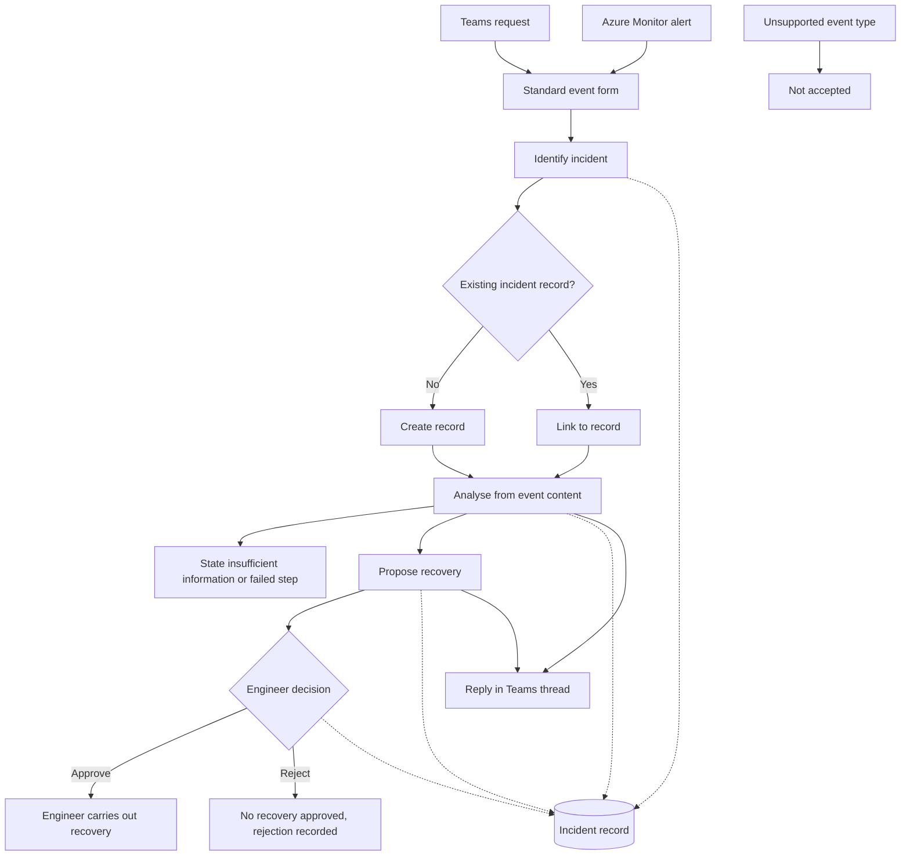

<!-- markdownlint-disable-file -->

# SRE Bot Managed Service Product Requirements

> **PRD-2026-Q4-001** | Status: draft | Version: 0.2.0 | Last Updated: 2026-11-23

> [!IMPORTANT]
> **DRAFT for human review.** Version 0.2.0 applies the automated quality review of v0.1.0 (report `PRD-2026-Q4-001-quality-20260523T050340Z`, Validate gate BLOCKED). The Validate gate has not been re-evaluated and Finalize has not started.
>
> - [ ] Reviewed and validated by a qualified human reviewer
>
> **Evidence labels.** *Fact* = stated by the source deck or a cited public source, not independently verified. *Assumption* = unsupported belief. *Decision* = confirmed by the user. *Proposed* = awaiting a human decision. *Unknown* = no evidence. No customer data, policy requirements, metrics or technical details have been invented.
>
> **Source business requirements.** The BRD (`.copilot-tracking/brd-sessions/sre-bot-managed-service-brd.md`, BRD-2026-Q4-001 v0.2.0) is an unreviewed draft with no `BRD_TO_PRD_HANDOFF_V1`. This PRD builds on it and cites its IDs, so any BRD change needs a PRD re-check.
>
> The source deck is marked CONFIDENTIAL (PALO IT) and is cited by slide only (C3). The user decided on 2026-11-23 that this marking is not a sharing constraint (D5). Evidence IDs (C#, W#) are defined in `.copilot-tracking/research/2026-11-23/sre-bot-context-discovery-research.md`. Context summary: `.copilot-tracking/research/2026-11-23/sre-bot-managed-service-context-summary.md`.

## Executive Summary

The SRE Bot Managed Service helps on-call engineers handle incidents. It accepts an alert or a Teams request, identifies the incident, proposes a root cause from the event content, proposes a recovery for the engineer to approve, and records every request and action on an incident record (Fact, C3 slides 2 to 5). In the MVP the bot proposes recovery and the engineer carries it out (Decision DD-001). GitHub Issues is the incident record and replaces Jira (Decision DD-006).

Target users are on-call engineers and the team that follows the incident record (Fact, C3 slides 3, 4). The MVP is one Azure path with two triggers, scoped for the HVE workshop and shown locally (Fact, C3 slides 5, 6; Decision DD-008). The release horizon is the workshop; its date and any commercial horizon are `Unknown` (OQ-017).

Primary success metric: `Unknown`. No baseline, target or volume exists (Success Metrics, OQ-002), so no goal yet passes SMART. The evidence does not support customer, buyer, price, accessibility needs, performance or availability targets. Azure SRE Agent documents overlapping capabilities (Fact, W1); positioning is deferred beyond the MVP (Decision DD-010, OQ-008).

---

## Product Context

* **User problem (Fact):** on-call engineers run detect, diagnose and recover by hand, and the deck frames this as alert fatigue (C3 slides 2, 3). Frequency, duration and cost are `Unknown`.
* **Product vision (Fact, C3 slides 2, 3):** faster, more consistent recovery with human oversight and an auditable system of record.
* **Competitive landscape:** Azure SRE Agent offers alert-driven investigation, Review and Autonomous run modes, tool-level allow, ask or deny, an audit trail, and integration with Azure Monitor, Teams and GitHub (Fact, W1), with usage-based billing (Fact, W2). Other alternatives, including non-AI automation, were not researched.
* **Discovery gaps:** no user research, interviews or incident history. All user statements below come from the deck.

---

## Users and Personas

| Persona | Evidence | Jobs to be done (wording Proposed, derived from C3 slides 3, 4) | Pain points | Success outcome |
|---|---|---|---|---|
| P1: On-call engineer | Fact (C3 slides 3, 4) | When an alert fires or I notice a recurring alert, I want the incident identified and a root cause and fix proposed, so I can approve a recovery without searching logs by hand. | Manual log search and diagnosis; manual recovery; alert fatigue | Approves or rejects a proposed fix with the evidence in front of them |
| P2: Team member following an incident | Fact (C3 slide 4, "the whole team stays aware") | When an incident is under way, I want one place to see what was asked and done, so I stay informed without asking. | Scattered updates | Sees every request and action on the incident record |
| P3: Platform and access administrator | Assumption | When the service needs access, I want its identity and permissions to be clear and limited. | `Unknown` | `Unknown` |
| P4: Managed-service operator (PALO IT) | Assumption | When I run the service for a customer, I want it observable and its actions auditable. | `Unknown` | `Unknown` |

The customer buyer, sponsor and decision-maker are `Unknown` (OQ-001).

---

## User Journeys

| ID | Journey | Steps | Basis |
|---|---|---|---|
| J1 | Alert-triggered incident | An Azure Monitor alert fires, the service accepts it, identifies the incident, records it, produces a root-cause analysis, proposes a recovery, the engineer approves or rejects, and the engineer carries out any recovery. | Fact (C3 slides 3, 5); step order from the deck |
| J2 | Teams request on a recurring alert | The engineer messages the bot about an alert that fired again, the bot replies in the same thread, links the incident to its existing record, and reports an analysis based on the event content it received. | Fact (C3 slide 4), amended by Decision DD-001 |

The deck's example says the bot is "pulling the log now". Under DD-001 the MVP uses only what arrives in the alert or message, so J2 follows DD-001 and the deck wording is superseded. The minimum event content is still `Unknown` (OQ-005).

---

## Design Decisions

| ID | Decision | Status | Basis |
|---|---|---|---|
| DD-001 | In the MVP, diagnosis uses only what arrives in the alert or Teams message, and the engineer runs any recovery. | Decision (user confirmed 2026-11-23) | D6; BRD DD-001 |
| DD-002 | Requirements describe product behavior. Platform and command names appear in constraints, the Glossary and interface notes. | Decision (authoring) | PRD convention |
| DD-006 | GitHub Issues is the incident record. Jira is not in scope, and the Jira mentions in the speaker notes are superseded. | Decision (user, 2026-11-23) | D4; BRD DD-005 |
| DD-007 | The deck's confidentiality marking is not treated as a sharing constraint for the deck and its summaries. Real incident, customer and tenant data still stay out of the repository. | Decision (user, 2026-11-23) | D5; BRD DD-006 |
| DD-008 | The MVP is shown locally. | Decision (user, 2026-11-23) | D7; BRD DD-007 |
| DD-009 | Treat alert, log, conversation and comment content as untrusted input, and define the service identity, permission limits, an emergency stop and action limits (NFR-003, NFR-004). | Proposed (awaiting human decision) | C6, C7; BRD DD-008 |
| DD-010 | Decide whether the offer is built, adopted from Azure SRE Agent, or combined with it before claiming differentiation. | Deferred beyond the MVP (DD-008) | W1, W2; BRD DD-009 |

DD-003, DD-004 and DD-005 were authoring conventions and moved to Authoring Notes in Document Metadata. Their numbers are not reused.

---

## Product Goals

```text
GOAL-001: Reduce the manual effort and elapsed time for an on-call engineer to reach a proposed recovery.
Priority: MUST
KPI: Time from event acceptance to a presented recovery proposal (M-01, M-02). Candidate; not defined in evidence.
Baseline: Unknown   Target: Unknown
Release horizon: Unknown (no date evidenced; requested under OQ-017)
Owner: Unknown (OQ-001)
Source: BRD BG-001. Evidence: Fact for intent (C3 slides 2, 3); Unknown for measure.
```

```text
GOAL-002: Keep an engineer in control of recovery and keep a traceable record of every request and action.
Priority: MUST
KPI: (a) Share of requests and actions with a record entry (M-03). (b) Share of presented proposals with a recorded engineer decision (M-06). Both candidates.
Baseline: Not applicable   Target: Every request and action recorded, and every presented proposal decided and recorded (deck rules, C3 slides 2, 3, 4)
Release horizon: Unknown (OQ-017)   Owner: Unknown (OQ-001)
Source: BRD BG-002. Evidence: Fact (C3 slides 2, 3, 4).
```

```text
GOAL-003: Demonstrate the MVP alert-to-incident-record path at the HVE workshop.
Priority: SHOULD
KPI: One demonstrated run for each of the two MVP triggers (M-05).
Baseline: Not applicable   Target: Both triggers demonstrated end to end
Release horizon: Workshop; date Unknown (OQ-017)   Owner: Unknown (OQ-001)
Source: BRD BG-003. Evidence: Fact for scope (C3 slide 6); Assumption that demonstration is the intended goal.
```

**SMART Evaluation** (from the v0.1.0 quality review; Unknowns are honest, not invented):

| Goal | Specific | Measurable | Achievable | Relevant | Time-bound |
|---|---|---|---|---|---|
| GOAL-001 | Met | Not met (no baseline or target) | Not judgeable | Met | Not met |
| GOAL-002 | Met | Met (both measures) | Met | Met | Not met (no date or owner) |
| GOAL-003 | Met | Met | Met | Weakened (demonstration is an Assumption) | Not met (workshop date Unknown) |

**Status**: fail. Goals stay SMART-incomplete until OQ-001, OQ-002 and OQ-017 are answered, or a human grants a waiver or dated deferral.

---

## Scope

**In scope for the MVP (Fact, C3 slides 5, 6):** Teams requests and Azure Monitor alerts as triggers; incident identification; root-cause analysis from event content; recovery proposals for engineer approval; recording on the incident record; replies in the Teams thread.

**Out of scope for the MVP (Fact, C3 slides 5, 6):** file uploads and screenshots; on-prem and SNMP alerts; scheduled jobs; AWS and GCP health events; email and web portal intake; non-Azure or local models; recovery without human approval. Also out of scope for this PRD: architecture, pricing, a competitor survey, and any service-executed recovery (DD-001).

---

## Functional Requirements

Each FR cites its BRD source and basis. IDs are PRD numbering. Command names are in the Glossary.

| ID | Requirement | Actor | Trigger | Expected outcome | AC | Goals | BRD source | Basis |
|---|---|---|---|---|---|---|---|---|
| FR-001 | The service accepts a request made by an engineer in Teams. "Accepted" is observable as an entry on the incident record or an acknowledgement in the thread (*Proposed* observable). | Engineer | A Teams message to the service | The request is accepted for handling | AC-001 | GOAL-001, GOAL-003 | FR-001 | Fact (C3 slides 4, 5, 6) |
| FR-002 | The service accepts an alert from Azure Monitor. "Accepted" is observable as an entry on the incident record (*Proposed* observable). | Monitoring source | An Azure Monitor alert | The alert is accepted for handling | AC-002 | GOAL-001, GOAL-003 | FR-001 | Fact (C3 slides 5, 6) |
| FR-003 | The service holds every accepted event in one standard form before further handling. The minimum fields are *Proposed*: the source type, the time received and the content as received. | Service | An accepted event | One consistent event form regardless of source | AC-003 | GOAL-001 | (PRD-originated) | Fact (C3 slide 5, "standardised event format"); fields `Unknown` (OQ-015) |
| FR-004 | The service identifies the incident, and the same input yields the same identification. | Service | A standard event | The incident is identified and recognizable on recurrence | AC-004 | GOAL-001 | FR-002 | Fact (C3 slide 3); matching rule `Unknown` (OQ-006) |
| FR-005 | The service creates an incident record for an incident that has none. | Service | An identified new incident | A record exists | AC-005 | GOAL-001, GOAL-002 | FR-002, FR-006 | Fact (C3 slide 5, record creation tool) |
| FR-006 | The service produces a root-cause analysis from the content of the event and cites the event content it relies on. | Service | An identified incident | An analysis with its cited basis is available to the engineer | AC-006 | GOAL-001 | FR-003 | Fact (C3 slide 3); DD-001; citing is *Proposed* |
| FR-007 | The service proposes a recovery for engineer review and does not carry it out. | Service | A completed analysis | A proposal is presented | AC-007 | GOAL-001, GOAL-002 | FR-004 | Fact (C3 slide 3); DD-001 |
| FR-008 (*Proposed*) | The service records the engineer's approval or rejection of a proposal. A proposal without a decision stays pending and is never treated as approved. Approver authority and time limits are `Unknown` (OQ-010, OQ-012). | Engineer | A presented proposal | The decision is on the incident record | AC-008, AC-022 | GOAL-002 | FR-005 | Fact (rule, C3 slides 2, 3); mechanism `Unknown` |
| FR-009 | The service records every request and every service action on the incident record. When the record cannot be written, NFR-009 applies. | Service | Any request or action | An entry exists on the record | AC-009 | GOAL-002 | FR-006 | Fact (C3 slides 2, 4) |
| FR-010 | The service reports status and results to the engineer in the Teams thread where the request was made. | Service | A request or a completed step | The result appears in that thread | AC-010 | GOAL-001, GOAL-003 | FR-007 | Fact (C3 slides 4, 5) |
| FR-011 | The service links a recurring incident to its existing incident record. | Service | An identified incident that already has a record | The recurrence points to the existing record | AC-020 | GOAL-001, GOAL-002 | FR-002 | Partially supported (C3 slides 4, 5); matching rule `Unknown` (OQ-006) |
| FR-012 | The service does not accept an event of an unsupported trigger type in the MVP. Whether the sender is told is `Unknown` (OQ-016). | Service | An event of another type | The event is not accepted | AC-021 | GOAL-003 | FR-008 | Fact (C3 slides 5, 6) |
| FR-013 | When the engineer rejects a proposal, the service treats no recovery as approved and records the rejection. How a revised proposal is requested is `Unknown` (OQ-016). | Engineer, service | A rejected proposal | No recovery is approved and the rejection is recorded | AC-023 | GOAL-002 | FR-009 | Fact (rule); revision path *Proposed* |
| FR-014 | When a step fails or the event holds too little information, the service says so instead of presenting an unsupported result. | Service | A failed step or insufficient information | The engineer sees a clear statement | AC-024 | GOAL-001 | FR-010 | *Proposed* (quality review) |

---

## Non-Functional Requirements

Evidence for non-functional needs is thin. Items marked *Proposed* are qualitative placeholders with `Unknown` targets, not invented numbers.

### Performance and Capacity

* NFR-008 (*Proposed*): The elapsed time from event acceptance to a presented proposal is measured (M-01). Target and window are `Unknown` (OQ-009). Owner: SME.

### Reliability and Resilience

* NFR-009 (*Proposed*): The service has a defined and observable behavior when the incident record or the conversation surface is unavailable or throttled (for example queue, retry or alert). The chosen behavior is `Unknown` (OQ-009). Basis: CON-005; FC-003, FC-004.

### Security

* NFR-001: Credentials and secrets used by the service are not present in code or on the incident record. Basis: Fact for the deck's use of a key vault (C3 slide 6); outcome wording *Proposed*.
* NFR-002: Every audit entry on the incident record identifies who or what acted and what the action was. Basis: Fact for auditability (C3 slides 2, 4); the two attributes are *Proposed*.
* NFR-003 (*Proposed*): The service treats content from alerts, logs, messages and comments as data and does not follow instructions found in it. Basis: C6, C7 (DD-009, OQ-010).
* NFR-004 (*Proposed*): The service acts under a defined identity with the least access needed, uses only the operations listed in CON-007, and has an emergency stop and action limits. Basis: Fact for the fixed operation set (C3 slides 5, 6); the rest is C6, C7 (DD-009, OQ-010).

### Privacy

* NFR-007 (*Proposed*): Incident content written to the incident record follows a decided classification, redaction and retention rule. The rule is `Unknown` (OQ-011). Basis: RK-005, FC-006.

### Scalability and Elasticity

Deferred. No scaling dimension or load range is evidenced (OQ-009). Not in the MVP.

### Maintainability and Operability

Not in the MVP beyond the observability item below. Deployment and configuration needs are `Unknown`.

### Observability

* NFR-005: The service reports operational telemetry about its own health. The signals, names and thresholds are `Unknown`; a plain-text observability note lists them once decided. Basis: Fact for the deck's listing of an application monitoring service under operations (C3 slide 6).

### Usability and Accessibility

No accessibility need or conformance level is evidenced (OQ-014). Accessibility of the Teams surface was not assessed.

* NFR-006 (*Proposed*): Service replies keep their meaning when read as plain text and do not rely on color or images alone. Basis: general practice; no user evidence.

### Compatibility and Interoperability

* NFR-010: The service interoperates with Microsoft Teams, Azure Monitor alerts and the incident record system named in CON-002. Basis: Fact (C3 slides 5, 6). Versions, schemas and protocols are `Unknown` (OQ-015).

### Portability

Deferred. Non-Azure and local models are later phases (CON-003). Not in the MVP.

---

## Guardrail Map

Each guardrail is specified in the requirement shown, not restated here. This map shows where the guardrails live.

| Topic | Specified in | Basis | Status |
|---|---|---|---|
| Engineer approval of the final fix | FR-007, FR-008, FR-013 | Fact (C3 slides 2, 3) | Stated |
| MVP proposes and does not execute recovery | FR-007, AC-007, DD-001 | Decision | Decision |
| Every request and action recorded | FR-009, NFR-002 | Fact (C3 slides 2, 4) | Stated |
| Fixed set of five record operations | CON-007, NFR-004, AC-012 | Fact (C3 slides 5, 6) | Stated |
| Secrets in a managed secret store | NFR-001 | Fact (C3 slide 6) | Stated |
| Untrusted content, identity, permissions, emergency stop, action limits | NFR-003, NFR-004, DD-009 | C6, C7; deck silent | Proposed |
| Incident content classification, visibility, redaction, retention | NFR-007, OQ-011 | Deck silent | Proposed |
| Model for the MVP | CON-003 | Fact (C3 slide 6) | Stated |

---

## Constraints

Scope is defined in the Scope section. CON-001 restates the trigger boundary of the MVP and is kept for traceability to AC-002 and AC-021.

| ID | Constraint | Imposing source | Affected boundary | Non-negotiable | Category | Impact | Evidence |
|---|---|---|---|---|---|---|---|
| CON-001 | The MVP accepts only Teams requests and Azure Monitor alerts. | Source deck | Scope | Yes for the MVP | Technical | FR-001, FR-002, FR-012 | Fact (C3 slides 5, 6) |
| CON-002 | The MVP runs on Azure with Microsoft Teams as the interaction surface and GitHub Issues as the incident record. No external imposer is confirmed. | Source deck (design choice) | Technology, integration | Unknown (OQ-007) | Technical | Platform for the MVP | Fact (C3 slides 4, 5, 6); Decision DD-006 |
| CON-003 | The MVP model is an Azure OpenAI deployment in Microsoft Foundry. Non-Azure and local models are later phases. | Source deck (design choice) | Technology | Unknown (OQ-007) | Technical | Model choice | Fact (C3 slide 6) |
| CON-004 | Real incident, customer and tenant data stay outside the repository. The deck's confidentiality marking is not a sharing constraint (DD-007). | Engagement evidence boundary (C1); user decision D5 | Evidence handling | Yes | Organizational | Evidence handling | Fact (C1); Decision (D5) |
| CON-005 | GitHub limits content creation to about 80 requests a minute and 500 an hour, with secondary limits that can change without notice. | GitHub | Integration, operations | Yes (external) | Technical | Burst handling for FR-009 | Fact (W3) |
| CON-006 | The MVP is scoped for the HVE workshop. The workshop date is `Unknown` (OQ-017). | Source deck | Schedule | Unknown | Schedule | Not a commercial release scope | Fact (C3 slide 6) |
| CON-007 | In the MVP the service uses only these five incident record operations: `create_issue`, `update_issue`, `add_comment` or `list_comments`, `get_issue`, `search_issues`. | Source deck | Integration | Yes for the MVP | Technical | Limits what FR-005, FR-009 and FR-011 can do | Fact (C3 slides 5, 6) |
| CON-008 | The MVP is shown locally. What that implies for hosting is open (OQ-016). | User decision D7 | Operations | Yes | Technical | Demonstration scope and dependencies | Decision (D7, DD-008) |

---

## Process Models



---

## Known Failure Cases

Only FC-001 is evidenced. The rest are unverified hypotheses. The expected behavior column is a Proposed test scenario, not a requirement, until a human decides.

| ID | Failure case | Basis | Expected behavior (Proposed) | Linked |
|---|---|---|---|---|
| FC-001 | A recurring alert fires again (the deck's disk-full example). | Fact (C3 slide 4) | Link to the existing record and report in the thread | FR-011, AC-020 |
| FC-002 | A wrong root cause is stated with confidence. | Hypothesis | Cite the event content used and require engineer review | FR-006, FR-007, OQ-005 |
| FC-003 | An alert burst creates many records or hits GitHub limits. | Hypothesis; W3 | Defined behavior under NFR-009; chosen behavior `Unknown` | NFR-009, CON-005, OQ-009 |
| FC-004 | Teams or the record system is unavailable. | Hypothesis | Defined behavior under NFR-009; chosen behavior `Unknown` | NFR-009, OQ-009 |
| FC-005 | Alert, log or message text contains instructions aimed at the model. | Hypothesis; C6, C7 | Do not act on it; proposals still need review | NFR-003, AC-016 |
| FC-006 | Sensitive log content is written to the incident record. | Hypothesis | Follow the rule decided under NFR-007 | NFR-007, OQ-011 |
| FC-007 | The event holds too little content for analysis. | Hypothesis (DD-001) | State that the analysis is limited | FR-014, AC-024, OQ-005 |

---

## Acceptance Criteria

| ID | Criterion | Covers | Status |
|---|---|---|---|
| AC-001 | Given a request made to the service in Teams, When it is received, Then it is accepted and the acceptance is observable on the incident record or in the thread. | FR-001 | Not Started |
| AC-002 | Given an Azure Monitor alert, When it is received, Then it is accepted and the acceptance is observable on the incident record. | FR-002 | Not Started |
| AC-003 | Given an accepted event from either source, When it is handled, Then it is held in one standard form that includes the source type, the time received and the content as received. | FR-003 | Not Started |
| AC-004 | Given the same alert content presented twice, When the service identifies the incident each time, Then both identifications are the same. | FR-004 | Not Started |
| AC-005 | Given an identified incident with no incident record, When it is handled, Then a record is created. | FR-005 | Not Started |
| AC-006 | Given an identified incident, When analysis completes, Then the analysis is available to the engineer and names the event content it relies on. | FR-006 | Not Started |
| AC-007 | Given a completed analysis, When the service proposes recovery, Then the proposal is presented for review and no recovery action is carried out by the service. | FR-007 | Not Started |
| AC-008 | Given a presented proposal, When the engineer approves or rejects it, Then the decision is recorded on the incident record. | FR-008 | Not Started |
| AC-009 | Given any request or service action, When it occurs, Then a corresponding entry exists on the incident record. | FR-009 | Not Started |
| AC-010 | Given a request made in a Teams thread, When a step completes, Then the status or result appears in that thread. | FR-010 | Not Started |
| AC-011 | Given the service and its incident record, When they are inspected, Then no credential or secret appears in code or on the record. | NFR-001 | Not Started |
| AC-012 | Given the service identity, When its permitted operations are listed, Then they are limited to the five operations in CON-007 and an emergency stop exists (limits `Unknown`). | NFR-004 | Not Started |
| AC-013 | Given an alert or message containing instruction-like text, When the service handles it, Then it does not act on that text and any proposal still requires engineer review. | NFR-003 | Not Started |
| AC-014 | Given incident content that falls under the decided classification rule, When it is written to the incident record, Then the rule's redaction applies (rule `Unknown`, OQ-011). | NFR-007 | Not Started |
| AC-015 | Given the service is running, When its integrations are inspected, Then it exchanges events with Microsoft Teams, Azure Monitor alerts and the incident record system named in CON-002. | NFR-010 | Not Started |
| AC-016 | Given the service is running, When health is inspected, Then telemetry about its own health is available and the signals are listed in the observability note (signals `Unknown`). | NFR-005 | Not Started |
| AC-017 | Given a service reply, When it is read as plain text without color or images, Then its meaning is unchanged. | NFR-006 | Not Started |
| AC-018 | Given an accepted event and a presented proposal, When elapsed time is reviewed, Then it can be read from the incident record. Target `Unknown`. | NFR-008 | Not Started |
| AC-019 | Given the incident record or Teams is unavailable or throttled, When the service tries to record or reply, Then the behavior defined under NFR-009 occurs and can be observed. | NFR-009 | Not Started |
| AC-020 | Given an incident that already has a record, When it recurs, Then it is linked to that record and no second record is created. | FR-011 | Not Started |
| AC-021 | Given an event of a trigger type other than Teams requests or Azure Monitor alerts, When it arrives, Then it is not accepted for handling in the MVP. | FR-012 | Not Started |
| AC-022 | Given a presented proposal with no engineer decision, When time passes, Then the proposal stays pending and is not treated as approved. | FR-008 | Not Started |
| AC-023 | Given a proposal the engineer rejects, When the rejection is made, Then no recovery is treated as approved and the rejection is recorded. | FR-013 | Not Started |
| AC-024 | Given a failed step or an event with too little information, When the service responds, Then it states the failure or the limit and does not present an unsupported analysis. | FR-014 | Not Started |
| AC-025 | Given an entry on the incident record, When it is read, Then it identifies who or what acted and what the action was. | NFR-002 | Not Started |

Thresholds for time, accuracy and availability are not set because no evidence supports them.

---

## Traceability Matrix

### Feasibility Candidate Disposition

No feasibility-to-PRD handoff was consumed. Not applicable.

### FR-to-AC Coverage

| FR | AC |
|---|---|
| FR-001 | AC-001 |
| FR-002 | AC-002 |
| FR-003 | AC-003 |
| FR-004 | AC-004 |
| FR-005 | AC-005 |
| FR-006 | AC-006 |
| FR-007 | AC-007 |
| FR-008 | AC-008, AC-022 |
| FR-009 | AC-009 |
| FR-010 | AC-010 |
| FR-011 | AC-020 |
| FR-012 | AC-021 |
| FR-013 | AC-023 |
| FR-014 | AC-024 |

Coverage: 14 of 14 FRs have an AC = 100.0%. Default threshold: `80.0%`.

### FR-to-GOAL Alignment

| FR | GOAL |
|---|---|
| FR-001 | GOAL-001, GOAL-003 |
| FR-002 | GOAL-001, GOAL-003 |
| FR-003 | GOAL-001 |
| FR-004 | GOAL-001 |
| FR-005 | GOAL-001, GOAL-002 |
| FR-006 | GOAL-001 |
| FR-007 | GOAL-001, GOAL-002 |
| FR-008 | GOAL-002 |
| FR-009 | GOAL-002 |
| FR-010 | GOAL-001, GOAL-003 |
| FR-011 | GOAL-001, GOAL-002 |
| FR-012 | GOAL-003 |
| FR-013 | GOAL-002 |
| FR-014 | GOAL-001 |

Coverage: 14 of 14 FRs have a GOAL = 100.0%. Target: `100.0%`.

### NFR-to-AC Verification

| NFR | AC |
|---|---|
| NFR-001 | AC-011 |
| NFR-002 | AC-025 |
| NFR-003 | AC-013 |
| NFR-004 | AC-012 |
| NFR-005 | AC-016 |
| NFR-006 | AC-017 |
| NFR-007 | AC-014 |
| NFR-008 | AC-018 |
| NFR-009 | AC-019 |
| NFR-010 | AC-015 |

### BRD-to-PRD Mapping

| BRD ID | PRD IDs |
|---|---|
| FR-001 | FR-001, FR-002 |
| FR-002 | FR-004, FR-005, FR-011 |
| FR-003 | FR-006 |
| FR-004 | FR-007 |
| FR-005 | FR-008 |
| FR-006 | FR-009 |
| FR-007 | FR-010 |
| FR-008 | FR-012 |
| FR-009 | FR-013 |
| FR-010 | FR-014 |
| BG-001, BG-002, BG-003 | GOAL-001, GOAL-002, GOAL-003 |
| NFR-001, NFR-002 | NFR-001, NFR-002 |
| BRD NFR-003 (reliability), NFR-004 (performance), NFR-005, NFR-006 (guardrails) | NFR-009, NFR-008, NFR-003, NFR-004 |
| CON-001 to CON-007 | CON-001 to CON-006, CON-008 (BRD CON-007 is PRD CON-008) |
| PRD-originated (no BRD source) | FR-003, CON-007 (five operations), NFR-005, NFR-006, NFR-007, NFR-010 |

---

## MVP and Release Framing

**First release (MVP, Fact, C3 slide 6):** FR-001 to FR-014 and the guardrails marked Stated or Decision in the Guardrail Map. Proposed items (NFR-003, NFR-004, NFR-006 to NFR-009, FR-008 as a whole) are in the first release only if a human accepts them.

**Deferred (Fact, C3 slides 5, 6):** file uploads and screenshots, on-prem and SNMP alerts, scheduled jobs, AWS and GCP health events, email and web portal intake, non-Azure or local models, recovery without human approval. Scalability and portability are deferred.

**Cut line rationale:** the deck defines the MVP as one alert-to-record path for the HVE workshop, shown locally (D7). A commercial release plan is `Unknown`.

**Dependencies (Fact unless stated):**

| Dependency | Basis | Status |
|---|---|---|
| Azure Monitor alert source | C3 slides 5, 6 | Details `Unknown` (OQ-015) |
| Microsoft Teams as interaction surface | C3 slides 4, 5, 6 | Details `Unknown` |
| Incident record system (GitHub Issues) | C3 slides 4, 5, 6; DD-006 | Plan, repository and visibility `Unknown` (OQ-011) |
| Azure OpenAI in Microsoft Foundry | C3 slide 6 | Availability `Unknown` |
| Managed secret store and application monitoring | C3 slide 6 | Details `Unknown` |
| Decisions OQ-001, OQ-010, OQ-011, OQ-016 | This PRD | Open |

---

## Success Metrics

| Metric | Definition | Baseline | Target | Window and source | Goal | Basis |
|---|---|---|---|---|---|---|
| M-01 Time to proposal | Time from event acceptance to a presented recovery proposal | Unknown | Unknown | Unknown | GOAL-001 | Assumption (candidate) |
| M-02 Engineer effort per incident | Engineer time spent per incident | Unknown | Unknown | Unknown | GOAL-001 | Assumption (candidate) |
| M-03 Record completeness | Share of requests and actions with a record entry | Not applicable | Every request and action (rule, C3 slides 2, 4) | Incident record | GOAL-002 | Fact (rule); measure candidate |
| M-04 Proposal approval rate | Share of proposals the engineer approves | Unknown | Unknown | Incident record | GOAL-002 | Assumption (candidate) |
| M-05 Workshop demonstration | Both triggers shown end to end | Not applicable | Yes or no | Workshop | GOAL-003 | Assumption |
| M-06 Proposal decision recorded | Share of presented proposals with a recorded engineer decision | Not applicable | Every presented proposal (rule, C3 slides 2, 3) | Incident record | GOAL-002 | Fact (rule); measure candidate |

Telemetry names and data sources are not defined. Use the `telemetry-foundations` skill when instrumentation is designed.

---

## Risks and Assumptions

### Key Assumptions

| ID | Assumption | Evidence status | Impact if false | Mitigation | Source |
|---|---|---|---|---|---|
| A-001 | The target customer runs Azure workloads with an on-call team. | Untested | Wrong scope | Confirm (OQ-001) | BRD A-001 |
| A-002 | Alert and Teams message content is rich enough for useful analysis. | Untested | Analysis quality too low | Define minimum content (OQ-005) | DD-001 |
| A-003 | A recurring alert should link to an existing record. | Partially supported | Duplicate records | Confirm rule (OQ-006) | C3 slides 4, 5 |
| A-004 | The Jira mentions in the speaker notes are stale. | Evidenced (user decision D4, DD-006) | Wrong scope | Closed | C3 notes; user |
| A-005 | Engineers review proposals carefully rather than approve by habit. | Untested | Unsafe approvals | Observe in workshop | PRD discovery |

### Research Finding Dispositions

| Gap ID | Evidence IDs | Affected targets | Disposition | Rationale | Primary research artifact |
|---|---|---|---|---|---|
| Finding: Business facts | C3 | Product Context, GOAL-001 | Incorporated | Concept consistent; impact unquantified | .copilot-tracking/research/2026-11-23/sre-bot-context-discovery-research.md |
| Finding: Affected users | C3 | Users and Personas | Incorporated | Only engineer and team evidenced | same |
| Finding: Business rules | C3 | FR-007, FR-008, FR-009, Guardrail Map | Incorporated | Stated in the deck | same |
| Finding: Constraints | C1, C3, W3 | CON-001 to CON-008 | Incorporated | Stated or documented | same |
| Finding: Diagnosis and recovery mechanism | C3, D6 | FR-006, FR-007, DD-001 | Incorporated | User confirmed option A | same |
| Finding: Known failure cases | none | Known Failure Cases, FR-014 | Retained-assumption | Only FC-001 evidenced | same |
| Finding: AI guardrails | C3, C6, C7 | NFR-003, NFR-004, DD-009 | Deferred | Proposed pending human decision | same |
| Finding: Azure SRE Agent overlap | W1, W2 | DD-010, OQ-008 | Deferred | MVP shown locally; positioning deferred (D7) | same |

### Risk Register

| ID | Risk | Probability | Impact | Mitigation |
|---|---|---|---|---|
| RK-001 | A wrong root cause is approved. | Medium (unverified) | High | FR-006 cites its basis; FR-014; FR-007; synthetic test cases |
| RK-002 | Prompt injection or excessive agency via event content. | Medium (unverified) | High | DD-009; NFR-003, NFR-004; AC-012, AC-013 |
| RK-003 | First-party overlap weakens differentiation after the MVP. | High | High (after the MVP) | DD-010; comparison deferred beyond the MVP |
| RK-004 | Alert bursts hit GitHub limits. | Medium (volumes unknown) | Medium | NFR-009; estimate volumes (OQ-009) |
| RK-005 | Sensitive content stored on incident records. | Medium (unverified) | High | NFR-007; decide rule (OQ-011) |
| RK-006 | Confidential deck over-shared. | Closed (D5, DD-007) | Not tracked | None |
| RK-007 | The deck says the bot pulls logs while the MVP does not. | Low (J2 corrected to DD-001) | Medium | Resolve minimum event content (OQ-005) |

---

## Open Questions

| ID | Question or gap | Why it matters | Owner | Status | Source |
|---|---|---|---|---|---|
| OQ-001 | Who is the target customer, buyer, sponsor and owner of each goal? | Personas, value, sign-off, goal owners | SME, PM | Open | BRD OQ-001 |
| OQ-002 | What are the baselines and targets for metrics M-01 to M-04? | GOAL-001 cannot pass SMART | SME | Open | BRD OQ-002 |
| OQ-003 | Is Jira in scope or only GitHub Issues? | CON-002 | SME | Resolved: GitHub Issues replaces Jira (DD-006) | BRD OQ-003 |
| OQ-004 | May the deck and summaries be shared beyond the team? | Evidence handling | Owner | Resolved: confidentiality marking is not a sharing constraint (DD-007) | BRD OQ-004 |
| OQ-005 | What is the minimum content of an alert or message, and what accuracy is expected from analysis? | FR-006, J2, FC-002, FC-007 | SME | Open | BRD OQ-005 |
| OQ-006 | What rule matches a recurring alert to an existing record? | FR-004, FR-011 | SME | Open | BRD OQ-006 |
| OQ-007 | Are Teams, Azure, GitHub Issues and the Azure OpenAI model non-negotiable beyond the workshop? | CON-002, CON-003 | PM | Open | BRD OQ-007 |
| OQ-008 | How does the offer position against Azure SRE Agent? | Differentiation | PM | Deferred beyond the MVP (D7, DD-008) | BRD OQ-008 |
| OQ-009 | What alert volumes, latency, availability and outage behavior are expected? | NFR-008, NFR-009, FC-003, FC-004 | SME | Open | BRD OQ-009 |
| OQ-010 | What identity, permissions, approver authority, emergency stop and injection controls apply? | NFR-003, NFR-004, FR-008 | Security, SME | Open | BRD OQ-010 |
| OQ-011 | What classification, visibility, redaction and retention apply to incident content? | NFR-007, RK-005 | Security, Owner | Open | BRD OQ-011 |
| OQ-012 | What severity, escalation and approval time-limit rules apply? | FR-008 | SME | Open | BRD OQ-012 |
| OQ-013 | What are the revenue model, price and channel? | Release framing | PM | Deferred (depends on OQ-001, OQ-008) | BRD OQ-013 |
| OQ-014 | What accessibility needs or conformance level apply, and how accessible is the Teams surface? | NFR-006 | PM, design | Open | PRD discovery |
| OQ-015 | What data does an Azure Monitor alert carry, which minimum event fields and exchange formats apply, and who configures the alert-to-service connection? | FR-002, FR-003, NFR-010, dependencies | SME | Open | PRD discovery |
| OQ-016 | What does "shown locally" mean for the MVP (local components, or Azure services demonstrated locally)? Is the sender told of an unsupported event, and how is a revised proposal requested? | CON-002, CON-003, CON-008, FR-012, FR-013 | SME | Open | D7; quality review |
| OQ-017 | What is the workshop date and review window, and is demonstration the intended goal for GOAL-003? | Time-bound and relevance of GOAL-001 to GOAL-003 | SME | Open | Quality review |

---

## Glossary

| Term | Definition | Context |
|---|---|---|
| SRE Bot, the service | The assistant that identifies incidents, analyses and proposes recovery | Deck term |
| Incident record | The single record where requests and actions are logged; a GitHub Issue per the deck | FR-009 |
| Fingerprint | Identifying an incident so recurrences map to it. The matching rule is `Unknown` (OQ-006). | C3 slide 3 |
| `/detect` | The deck's command that identifies and fingerprints an incident (FR-004, FR-011) | C3 slide 3 |
| `/analysis` | The deck's command for root-cause analysis (FR-006) | C3 slide 3 |
| `/recover` | The deck's command that proposes recovery (FR-007). In the MVP it does not execute. | C3 slide 3; DD-001 |
| MVP | The workshop-scoped first version, shown locally | CON-006, CON-008 |

---

## Sign-Off

### Approval Checklist

* Product Sponsor: Unassigned - approves product opportunity and strategic alignment.
* Product Owner: Unassigned - approves requirements completeness and feasibility.
* Technical Lead: Unassigned - approves technical feasibility and constraints.
* Quality Lead: Unassigned - approves quality criteria and acceptance coverage.
* Legal/Compliance: Unassigned - approves regulatory and policy compliance when required.

Approval date: Not approved.

### Waivers

None recorded.

### Handoff Readiness

Not ready. The Validate gate was BLOCKED on v0.1.0 and has not been re-evaluated on v0.2.0. The source BRD is an unreviewed draft, all goals are SMART-incomplete, several NFRs are only Proposed, and sponsor and approver ownership are not named. No downstream backlog handoff was produced.

---

## Disclaimer

> [!CAUTION]
> **Disclaimer:** This agent is an assistive tool only. It does not provide product management approval, technical feasibility validation, or business sign-off and does not replace product managers, engineering leads, business stakeholders, or other qualified human reviewers. The output consists of suggested requirements, acceptance criteria, and product specifications to support a user's own product planning and decision-making. All Product Requirements Documents, functional requirements, non-functional requirements, and constraint definitions generated by this tool must be independently reviewed and validated by appropriate product and engineering reviewers before adoption. Outputs from this tool do not constitute product approval, requirements sign-off, or engineering commitment.

---

## Document Metadata

* Template Version: 1.0.0.
* Canonical Template: `requirements-author/templates/prd/prd-full.md`.
* License: CC-BY 4.0 (Microsoft HVE-Core).
* Attribution: Microsoft HVE-Core Team.
* Revision: 0.2.0 applies the automated quality review findings that needed no new facts. Findings that need new facts remain as open questions.
* Sources: BRD `.copilot-tracking/brd-sessions/sre-bot-managed-service-brd.md`; research `.copilot-tracking/research/2026-11-23/sre-bot-context-discovery-research.md` (C1, C3, C6, C7, W1, W2, W3; C3 is the source deck).

### Authoring Notes

* AN-001 (was DD-003): Baselines and targets stay `Unknown` rather than estimated.
* AN-002 (was DD-004): The PRD and state file are stored under `.copilot-tracking/prd-sessions/`, as the user instructed.
* AN-003 (was DD-005): BRD IDs are preserved as source references. PRD FR and AC IDs are new numbering.
